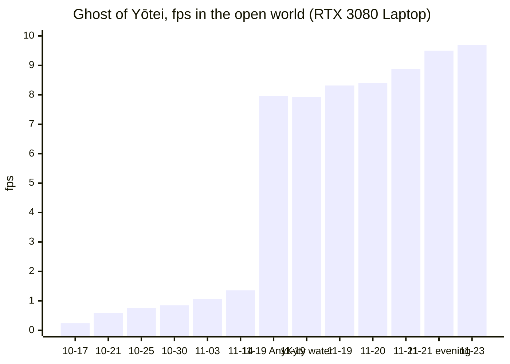
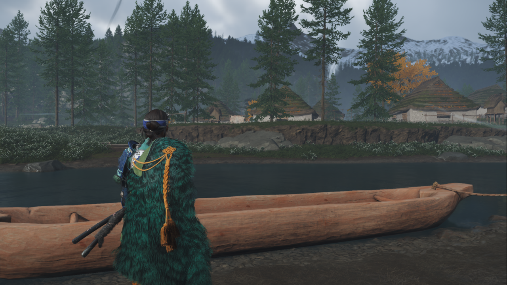
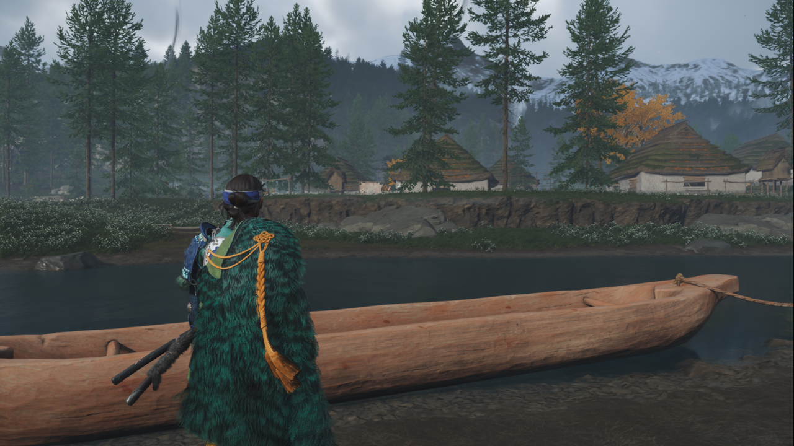
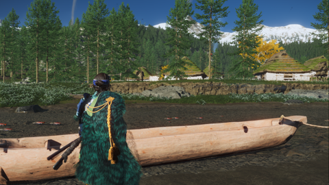
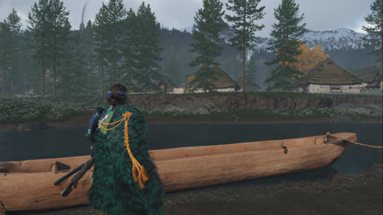
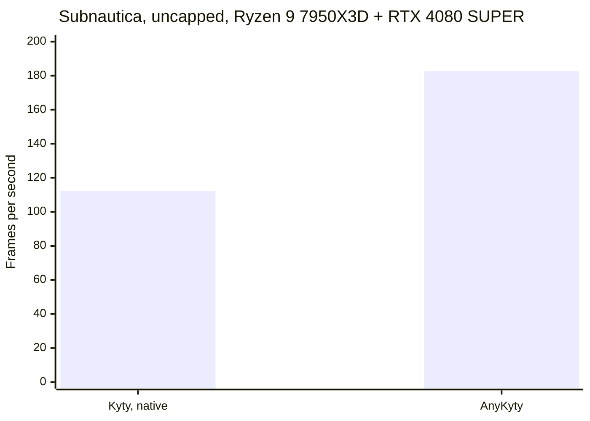
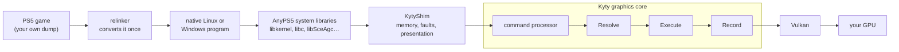

<h1 align="center">Ghost of Yōtei on AnyKyty</h1>

<p align="center"><b>Ghost of Yōtei (PPSA26344, v1.008) running in its open world on PC, on <a href="https://github.com/simnJS/AnyPS5/tree/AnyKyty">AnyKyty</a>: AnyPS5 with the Kyty graphics core.</b><br>
<sub>Branch <code>yotei/best</code> on Celegans12/AnyPS5-Ghost-of-Yotei · progress thread: <a href="https://github.com/boykopovar/AnyPS5/discussions/675">#675</a> · AnyKyty thread: <a href="https://github.com/boykopovar/AnyPS5/discussions/22713">#22713</a> · <a href="#run-it">run it</a> · <a href="#updates">updates</a></sub></p>

<table>
<tr>
<td align="center"><b>~9.7 fps</b><br><sub>in the world, 1080p<br>RTX 3080 Laptop (measured)</sub></td>
<td align="center"><b>~15 fps</b><br><sub>in the world, 1080p<br>RTX 4090 + i9-13900K (measured by Pipodi<br>on an older build*)</sub></td>
<td align="center"><b>×40</b><br><sub>since the first time<br>in the open world (10-17)</sub></td>
<td align="center"><b>~40 s</b><br><sub>from the window<br>to the world (warm cache)</sub></td>
</tr>
</table>

> [!NOTE]
> A work-in-progress test branch, not upstream code: simnJS's `AnyKyty` (`7de61e3451c`, 2026-11-23) plus 8 commits of
> ours. Most of what this branch used to carry is in `AnyKyty` now (the DLL build, the 11_11_10 blend, the ahead-walk
> deferral, the in-place label deferral, the KytyPS5 correctness fixes, the shorter SRT walkers, the image-heap repoint
> and the Windows stage-thread placement among them), so what is left here are two of our open PRs (a fix for a rare
> crash in the SRT walker, simnJS/AnyPS5#269, and a startup note for `KYTY_*` variables this build doesn't read,
> simnJS/AnyPS5#235), three small SRT-walk speed-ups, two diagnostics for rare stops, and the per-shader GPU timer
> `KYTY_GPU_TIME` (off by default).
> Until 2026-11-17 this branch was AnyPS5's own GPU driver; that build is kept as
> [`yotei/best-anyps5-2026-11-17`](https://github.com/Celegans12/AnyPS5-Ghost-of-Yotei/tree/yotei/best-anyps5-2026-11-17).

## Where it stands (2026-11-23)

| | |
|---|---|
| **Furthest point** | Open world, from a save near Teshio Ridge (the river village with the canoe) |
| **Frame rate, laptop** | **about 97 presents per 10 s (~9.7 fps)** at 1080p with the [1080p patch](#run-it), standing still, 300 s legs, warm cache (two legs on 11-23: 97.7 and 95.5, against 94.6 and 94.2 for the 11-21 build in alternating legs of the same session, +2.3 %). Measured on an i9-11900H + RTX 3080 Laptop 16 GB |
| **Frame rate, desktop (measured*)** | **152-154 presents per 10 s (~15 fps)** on an RTX 4090 + i9-13900K, the same save and settings, measured on the 11-20 build (not yet on this one). An RTX 5080 desktop should land in the same range |
| **Time to the world** | about 40 s after the window opens with a warm cache. The first run with an empty cache compiles its pipelines first and takes much longer (a few huge compute pipelines take minutes each in the NVIDIA driver) |
| **Picture** | Water, foliage, rocks and characters render correctly in our scene. Ray-traced effects don't run yet: AnyKyty doesn't serve Yōtei's compute-shader BVH walks, so those rays miss (simnJS/AnyPS5#111) |
| **Stability** | Our runs in the world are clean until we stop them; the depth-target crash of the earlier builds is fixed in `AnyKyty` |
| **Tested on** | Windows 11, RTX 3080 Laptop GPU 16 GB (driver 621.14), i9-11900H, 32 GB RAM; AnyPS5 with MinGW-w64 GCC 15.2.0, `kyty_gpu.prx` with llvm-mingw 20261104. Not tested on Linux |
| **Build** | `7ea5479c002` (simnJS `AnyKyty` `7de61e3451c` + our 8 commits), plus this README, the 1080p patch and the Yōtei profile in `docs/yotei/` (trained on this code) |

<sub>* Measured by Pipodi on 2026-11-20 with this branch at our save (#675, comment 19773554): 400 s legs on a filled cache, about
1.8 times our laptop, GPU around 77 % busy, about 4.7 cores used. Yōtei on Kyty is limited by the CPU side, so a faster GPU
alone changes little; our earlier estimate of 18-23 fps for a desktop was too optimistic. More numbers are welcome in #675.</sub>

## Speed over time



| Milestone | Date | fps (laptop) |
|---|---|---|
| First time in the open world, AnyPS5's own driver | 10-17 | 0.24 |
| Bindless, owned textures, the second Vulkan queue | 10-21 to 10-26 | 0.6-0.8 |
| 1080p patch, committer and preparer work from contributors | 10-30 to 11-03 | 0.85-1.06 |
| Best AnyPS5-driver build | 11-14 | 1.36 |
| **Moved to AnyKyty** (Kyty core as a libc++ DLL, PGO trained on Yōtei) | 11-19 | **7.97** |
| **Water fixed** | 11-19 | 7.93 |
| **Newest AnyKyty, exact 11_11_10 blend** | 11-19 | **8.32** |
| **Ahead SRT walks keep going past shader-only words** (+1.7 % in the same session) | 11-20 | **8.27** |
| **Profile retrained on the new code** (+3.4 % in the same session), a rare stop on a recycled texture slot fixed | 11-20 | **8.32** |
| **Ahead SRT walks read clean lines of GPU-written pages** (+6 % in the same sessions), newest AnyKyty, profile retrained | 11-21 | **8.88** |
| **AnyKyty with the cloth wave64 fix, write-tick recycling on, profile retrained** (+2.8 % in the same session) | 11-21 evening | **9.5** |
| **Newest AnyKyty (most of our commits now upstream), SRT walker crash fix, profile retrained** (+2.3 % in the same session) | 11-23 | **9.7** |

<sub>Different days were measured in different sessions; this laptop's clocks drift by up to ~14 % between sessions, so
small steps aren't comparable across rows. The full table is [below](#how-the-frame-rate-got-here).</sub>

### At our save, 11-21 build and this one

Both shots at 180 s into a run, on an overcast launch (the weather is picked at each launch, so we compare only runs
that got the same weather):

<table>
<tr>
<td width="50%"></td>
<td width="50%"></td>
</tr>
<tr>
<td align="center"><sub>11-21 build (94 presents per 10 s)</sub></td>
<td align="center"><sub>This build (96-98 presents per 10 s): water, clouds, foliage and lighting the same</sub></td>
</tr>
</table>

### Water: before and after the fix

<table>
<tr>
<td width="50%"></td>
<td width="50%"></td>
</tr>
<tr>
<td align="center"><sub>Before: the water appeared for a frame and faded out, so the riverbed showed</sub></td>
<td align="center"><sub>After (simnJS/AnyPS5#103): the water stays</sub></td>
</tr>
</table>

### Same code, three ways of building it

All three were measured in the same session, back to back, with the same save, settings and 300 s runs (older base):

| Build | Presents per 10 s |
|---|---|
| Kyty core linked into AnyPS5 (clang against GCC's libstdc++; AnyKyty's normal build) | 61.9 |
| Kyty core as `kyty_gpu.prx` (clang + libc++ + ThinLTO, AnyKyty's shared profile) | 74.2 (+20 %) |
| the same DLL with the profile trained on Yōtei (`docs/yotei/kyty_gpu-yotei.proftext`) | **79.7** (+29 % over the normal build) |

### What still limits it

- **Kyty's execution thread**, which prepares every draw, sets the frame time: the GPU is idle about 40 % of each frame. A
  quarter of that thread goes to per-draw program lookup and resource setup.
- **Write tracking:** about 13,700 guest write faults per second. About half are in the game's command buffers and a
  third next to GPU-written pages. simnJS is working on both in `AnyKyty`.
- **GPU work:** about 67 ms per frame on the laptop's GPU (measured on 11-23 with `KYTY_GPU_TIME=1`; the cloth solver
  alone about 13 ms), which alone would cap it near 15 fps there.
- **Ray tracing** isn't served yet (see above), and **a cold first start** is slow.

## How the frame rate got here

The rows up to 11-17 are AnyPS5's own GPU driver (the old `yotei/best`); the row from 11-19 is AnyKyty. Rows from different days were measured in different sessions; this laptop's GPU clocks drift by up to ~14 % between sessions.

| Date | Presents per 10 s in the world | What changed |
|---|---|---|
| 10-17 | 2.35 | first time in the open world |
| 10-18 | 2.97 | cheaper draw-cache keys |
| 10-18 | 3.9 | texture revalidation walks only the readable parts of partly committed memory |
| 10-18 | 4.2 | hand-off PRs from upstream, copy-backs of changed dwords only |
| 10-18 | 4.6 | draw preparer thread, device-local buffers for the cloth compute programs |
| 10-19 | 5.0 | the cloth compute ring on its own Vulkan queue |
| 10-19 | +5 % presents, -8 % frame time vs the build above, same session | indirect-draw records read on the GPU, exact f32 path for f16 mix math (one pass 101 -> 27 ms GPU), presenter and barrier trims |
| 10-19 | **5.1** (+9 % in an in-run A/B, ~2.7 SE) | a dispatch run's staged copy-ins in one prelude with one barrier instead of a barrier per dispatch: the cloth queue's GPU time halves, GPU busy -26 % |
| 10-21 | **5.0** (the previous build got 4.19 in the same session: +19 % presents, -13 % frame time) | merged with `main` 2026-10-20; three fixes for slowdowns `main` added in the draw committer (buffer pool tiers, exact-size buffer reuse, held-read checks: +18 % in an in-run A/B); the second Vulkan queue off |
| 10-21 | **5.9** (lane off 5.45 in the same session: +8 % presents, -16 % median frame; provisional) | the cloth compute ring's second Vulkan queue back on, now on a compute-only queue family |
| 10-21 | +11 % in an in-run A/B (6.26 vs 5.62) | hritikutekar's two committer fixes: a count of prepared bindless tables instead of a full walk every 4 ms, and small texture snapshots in pooled slabs |
| 10-22 | **5.2** (the previous build with hritikutekar's fixes: 5.13 in the same session) | merged with `main` 2026-10-21; same speed, newer `main` underneath |
| 10-24 | +2.8 % / +2 % / +3 % in in-run A/Bs | hritikutekar's second committer batch; #7514; queue-0 dispatches through the draw pipeline (`APS5_PIPELINE_DISPATCH=1`) |
| 10-24 | even with the build before | merged with `main` 2026-10-24 |
| 10-25 | **7.6** (7.2 with them off in the same run: +8.5 %, frames ~100 ms shorter) | owned texture proofs: the committer's texture checks become a few word reads instead of a memory walk |
| 10-25 | +1.8 % in an in-run A/B | shahulmubeen-a's HTILE note for cache-hit dispatch items (#2) |
| 10-26 | **8.05** (7.70 with them off in the same run: +4.4 %, frames ~55 ms shorter) | owned reuse of untracked vertex/index inputs and draw snapshots; storage flushes wait only for the lanes that write the range |
| 10-26 | **7.8** (7.3 with all owned features off in the same run: +6.4 %, frames ~80 ms shorter) | the owned features made fault-free: write watch instead of write protection, answered from per-block checks within each collect epoch |
| 10-27 | **7.9** (the build before: 7.75 between two runs of this one, same script) | merged with `main` 2026-10-26; same speed, newer `main` underneath |
| 10-30 | **8.74** at 1080p (8.07 with them off in the same run: +8.4 %, GPU busy -170 ms per frame) | hritikutekar's resident device buffers for hot staged ranges: a staged range that's copied in again and again gets its own device buffer, and the copy-in is skipped while guest memory hasn't changed (copy-in 9,295 to 2,461 MiB per 10 s) |
| 10-30 | **8.46** at 1080p (7.76 / 7.64 at 4K in the runs either side: +9.9 %) | the game's output and render size set to 1920x1080 with a relinker patch (shahulmubeen-a's, ported to v1.008); at 4K the code runs at the same speed as the build before (7.98 against 7.95 / 7.91) |
| 11-03 | **10.60** at 1080p (10.30 / 10.03 for the build before in the runs either side: +4.3 %) | hritikutekar's preparer commits, Pipodi's miss-ahead builds and TheBlenDed's VRAM yield (gate off) |
| 11-03 | +5 % in an in-run A/B (9.80 vs 9.28, 23 pairs, ~4.6 SE) | `APS5_DEFER_LABEL_READBACK=1` and `APS5_RESOURCE_CACHE_LARGE=1`: label read-backs recorded behind their writer instead of a CPU wait, and a resource cache of at least 4,096 entries |
| 11-14 | **13.6** at 1080p on driver 621.14 (13.13 / 13.57 for the build before in the same session: about +2 %, within the spread) | kiansaeidnia's snapshot reads and APR file reads, Pipodi's pipeline prebuilds, eleven of slopezjur's driver commits and one of Zenodeon's |
| 11-14 | even with the build before (12.83 / 13.28 against 13.04 / 13.45 in alternating runs) | the GPU stack moved onto `main` 2026-11-13: `main`'s libraries, relinker and build under our driver and recompiler |
| 11-15 | even with the build before: 11.50 / 11.97 on the new `main` against 11.79 / 11.09 in four alternating 1,500 s runs at 1080p (+2.6 % on average, inside the spread: the build before alone moved 6 % between its two runs) | the same GPU stack moved from `main` 2026-11-13 to `main` 2026-11-15 (about 1,480 commits of `main`'s libraries, relinker and build) |
| 11-16 | level (+1.6 % / -0.4 % in two in-run A/Bs, inside the noise), GPU busy -6 %, staging-in GPU -36 % | `APS5_STAGING_DIFF_HANDOVER=1`: a staged range used twice in one batch keeps its device-local shadow and gets one changed-bytes copy-back |
| 11-17 | even with the build before within the spread: 11.01 / 11.22 on the new `main` against 10.88 / 12.11 in four alternating 1,500 s runs at 1080p (-3.3 % on average; the build before alone moved 11 % between its two runs, and the scene work per frame differed by 3-12 % between neighbouring runs, so no pair carries a speed claim) | the same GPU stack moved from `main` 2026-11-15 to `main` 2026-11-17 (about 2,060 commits of `main`, among them slopezjur's #20017, the fix for the `unsupported PM4 packet type` aborts reported on game 02.002.000) |
| 11-19 | **79.7** at 1080p on AnyKyty (74.2 for the same code without the Yōtei profile and 61.9 for AnyKyty's normal build, same session) | moved to AnyKyty (simnJS's AnyPS5 with the Kyty graphics core) with our Yōtei fixes, the Kyty core built as `kyty_gpu.prx` and a profile trained on Yōtei |
| 11-19 | **81.3** at 1080p (79.0 on the same base without it) | AnyKyty `b0f7dda885b`, and a guest fault that waits for a pending texture write-back no longer queues behind every other GPU command (21 ms to 0.7 ms per wait) |
| 11-19 | **79.3** at 1080p, water fixed | AnyKyty `97c16b5f271` with the depth-target crash fix, our water fix, the title framed with `--frame-red-zone` |
| 11-19 | **83.2** at 1080p | AnyKyty `de2889cc67b` (write blocks only in command buffers, more fixes), our exact 11_11_10 blend, the DLL commits of simnJS/AnyPS5#123; the title framed without `APS5_ALLOW_UNFRAMED_FAULTS` |
| 11-20 | **82.7** at 1080p (81.3 with `KYTY_FLAT_DEFER=0`, three alternating pairs in one session) | the same base; an SRT walk done ahead of execution no longer stops at a GPU-written page when only the shader reads that word (0 differences in 739,107 checked resolutions), and the 11_11_10 blend reads its destination back with a rounded-up reciprocal (simnJS/AnyPS5#119) |
| 11-20 | **83.2** at 1080p (four legs, 80.0 to 85.6) | the same code with the PGO profile trained again on it: **85.4 against 82.5** with the old profile, three alternating pairs in one session (+3.4 %). Then a fix for a rare stop (`TileGetTiledTextureLayout`) when a bindless texture slot is read while the game recycles it, and the profile trained once more on that final code; level with the build before it (83.2 against 83.1) |
| 11-20 | **83.5** at 1080p (three legs, 81.6 to 84.6; 83.5 for the build before it in the same session) | moved to AnyKyty `82039de9258` (texture tables served through the image heap, descriptor table writes), all our commits rebased, the profile trained on it |
| 11-20 | **85.8** at 1080p (three legs, 85.5 to 86.3; 84.6 for the build before it in the same session) | moved to AnyKyty `de0fa047bb0`: an empty buffer slot shares the bound shader variant (simnJS, from our finding), a CPU deadlock fixed; the profile trained on it. A first boot without a save now gets through the opening cinematic to the kanji prompt in about 23 minutes on the laptop (946 s of compile stalls; before: 1,594 s and stuck in the cinematic at 30 minutes) |
| 11-20 | **85.4 and 81.7** at 1080p (85.7 and 86.4 for the build before it in the same session: level within the spread) | moved to AnyKyty `ce8cd4221e1`: the cloth/particle solver hang fixed (stale parameter block), the heap corruption in parallel shader compiles fixed, a new image-table shape of a compute shader runs at once on a wider module instead of freezing for its compile; all our PRs merged upstream |
| 11-21 | **88.1 and 89.5** at 1080p (86.0 for the build before it in the same session) | moved to AnyKyty `0c09d875506` (guest write faults handled without the region lock, signal delivery fixes) with the profile trained on it, and a new step of ours: an SRT walk done ahead of execution reads a word on a GPU-written page from the CPU copy when its 64-byte line holds no GPU bytes, and the execution thread checks every such read before it uses the result. About 55,000 resolutions per 10 s now finish ahead that used to be redone. On the build before this move: **89.8 against 84.6** with it off (seven and six legs over three sessions, +6 %); exact, 0 differences in three verify legs that compare every such resolution with a full one |
| 11-21 | **88.8, 87.9 and 87.5** at 1080p (88.9 on average for the build before it in the same session: level) | moved to AnyKyty `8ebb72d680d`: simnJS's resolve thread now reads around GPU writes and prepares image-heap programs ahead (his version of our clean-line reads, measured on Yōtei, so ours is dropped), GPU-produced control words are left to the GPU, wave64 compute runs as two 32-wide halves; with our shorter SRT walkers (KytyPS5, exact: 0 differences in about 14 million compared walks) and the profile trained on it. GPU work per frame 70 against 79 ms: particles about half, the cloth solver about 20 % slower |
| 11-21 | **94.9 and 95.4** at 1080p (92.4 and 92.7 in the same session for an unpublished in-between build: +2.8 %, both pairs; that build had measured 90.1 and 93.9 against 85.9 and 83.1 for the afternoon build in an earlier session) | moved to AnyKyty `70f1d69fb6c`: simnJS's wave64 fix for the cloth solver (a wave64 group of several waves stays in lane pairs unless the split is needed), image-heap programs refused on the resolve thread again, live stencil storage kept across tile layouts, pixel helper lanes in quad operations, GPU-written images written back and freed when idle, and our in-place label deferral merged upstream. Ours on top: write-tick nodes recycled instead of freed and allocated at every draw and dispatch (on by default; exact, 0 mismatches in 23 verify windows), and the profile trained on this code. Picture identical to the build before at the same spot apart from the clouds |
| 11-23 | **97.7 and 95.5** at 1080p (94.6 and 94.2 for the 11-21 build in alternating 300 s legs of the same session: +2.3 % on average, ahead in both pairs) | moved to AnyKyty `7de61e3451c`: twelve of our commits are upstream now (the KytyPS5 correctness ports, the image-heap repoint of changed slots, the Windows stage-thread placement), simnJS's own port of the shorter SRT walkers (+4 % in his A/B), Kyty as the only GPU driver, and fixes from several contributors. Ours on top: a fix for a rare SRT walker crash (simnJS/AnyPS5#269), a startup line for unread `KYTY_*` variables (simnJS/AnyPS5#235), three small SRT-walk speed-ups, and the profile trained on this code. Write-tick recycling is dropped (level on the newer base). Picture the same as the 11-21 build at the same spot and weather |

## Run it

**Windows only for now** (we've only built the DLL there). You need the usual AnyPS5 toolchain
([build instructions](docs/dev/BUILD.md)) and, for `kyty_gpu.prx`, [llvm-mingw](https://github.com/mstorsjo/llvm-mingw)
(we use the 20261104 release). First turn the Yōtei profile into the indexed form clang reads, with the
`llvm-profdata` from the same llvm-mingw:

```
llvm-profdata merge -o kyty_gpu-yotei.profdata docs/yotei/kyty_gpu-yotei.proftext
```

Then configure and build:

```
cmake -S . -B build -G Ninja -DCMAKE_BUILD_TYPE=Release -DCMAKE_C_COMPILER=gcc -DCMAKE_CXX_COMPILER=g++ ^
  -DANYPS5_KYTY_DLL=ON ^
  -DANYPS5_KYTY_DLL_C_COMPILER=<llvm-mingw>/bin/x86_64-w64-mingw32-clang.exe ^
  -DANYPS5_KYTY_DLL_CXX_COMPILER=<llvm-mingw>/bin/x86_64-w64-mingw32-clang++.exe ^
  -DANYPS5_KYTY_DLL_PGO=USE -DANYPS5_KYTY_DLL_PGO_PROFILE=<full path>/kyty_gpu-yotei.profdata
cmake --build build
```

Without `-DANYPS5_KYTY_DLL=ON` you get AnyKyty's normal build (about 20 % slower here). The build puts
`kyty_gpu.prx` next to the other libraries, and libSceAgcDriver loads it at startup. On this base Kyty is the only GPU
driver, so `-DANYPS5_GPU_BACKEND=kyty` is no longer needed (it is still accepted; an old build directory configured with
another value has to be configured anew).

For 1080p (recommended), add the patch file [`docs/yotei/yotei-1.008-1080p.toml`](docs/yotei/yotei-1.008-1080p.toml)
to your relinker command. It is shahulmubeen-a's 1080p patch for 02.002.000, ported to v1.008; this build's relinker
applies all five of its sites. It is for v1.008 only (app0/eboot.bin md5 `748168945449666277eb772f7a371cbc`).

```
python tools/unwrap_self.py <dump>/app0/eboot.bin eboot.elf
relinker <your usual options> --frame-red-zone --patches docs/yotei/yotei-1.008-1080p.toml eboot.elf <runtime>/eboot.exe
```

**`--frame-red-zone` is the relinker's default on this base** (a Windows conversion with the Kyty backend frames the red zone by itself; passing the option is harmless). AnyKyty tracks guest writes with page faults, and on Windows a fault can overwrite values a leaf function keeps below the stack pointer, so AnyKyty stops at startup unless the title was converted with it. In Yōtei 1.008 the relinker frames 404 of the 406 such functions and lists the last 2 in the title's mark; AnyKyty then only stops if a fault lands inside those 2 small ranges, which didn't happen in our runs. A build of the earlier `yotei/best` (older relinker) still needs `APS5_ALLOW_UNFRAMED_FAULTS=1`.

Our numbers are measured with:

```
KYTY_ASYNC_PIPELINES=0 KYTY_GPU_SPIN_US=0
```

- `KYTY_ASYNC_PIPELINES=0` makes a draw wait for its pipeline instead of skipping it while the pipeline compiles in
  the background, so nothing pops in. `2` crashed for us, and AnyKyty's default is back to `1` while simnJS traces a heap corruption with `2`.
- `KYTY_GPU_SPIN_US=0` turns off the 2 ms spin before a GPU wait. On this 8-core laptop it makes no difference to the
  frame rate (0 against the default 2000: -0.6 %, inside the noise of an in-run A/B), but the GPU stage threads use
  about 1.3 cores less, which leaves room for the rest of the system. On a desktop with more cores the default may be
  as good or better (simnJS measured 0 as 4.8 % slower in Stray), so compare both if you report numbers.
- Every other AnyKyty setting is at its default; [the AnyKyty page](docs/user/ANYKYTY.md) lists them all. At start the
  log names any `KYTY_*` variable you set that this build doesn't read (`[kyty] <name> is set but not read by this
  build`), so a misspelt or removed setting no longer goes unnoticed.
- Leave `ANYPS5_VBLANK_HZ` unset; with `240` the earlier builds crashed.

## Known issues

- **Exit after a fatal error can hang.** If the log ends in `--- Fatal Error ---` and the window doesn't close, end
  `eboot.exe` in Task Manager.
- **The first run after an update compiles shaders again**: the shader translation changed upstream since the 11-21
  build, so its cache entries no longer match. Later runs are warm.
- The PGO profile was trained on one save, standing in the world. Other scenes may gain less than the 7.5 % it gave
  here; we haven't measured them.

## What it carries on top of AnyKyty

Ours and not in `AnyKyty` yet (8 commits):

- **SRT walker code on pages of its own** (simnJS/AnyPS5#269, open): the walker code came from the C runtime heap and was
  made executable there; when the heap committed such a page again it went back to read-write, and the next walk on it
  crashed with an access violation in `kytyGpuResolve` (3 of about 8 starts in one of our test series). The code now
  comes from its own `VirtualAlloc` pages.
- **A startup line for every `KYTY_*` variable this build doesn't read** (simnJS/AnyPS5#235, open).
- **Three small SRT-walk speed-ups on the execution thread**: a page that may hold GPU-written bytes is looked up once
  per walk instead of probed at every load (a clean page is then read in line from its backing), the walker's page cache
  test is one instruction shorter per load, and the walk's captured reads are appended in one pass (KytyPS5 `657a94e7`,
  nmzik).
- **Two diagnostics for rare stops**: the source of a texture descriptor whose tile mode has no layout
  (`KYTY_TILED_DIAG=1`), and the surface and its caller when a format has no element layout.
- **`KYTY_GPU_TIME=1`**: GPU time per shader and per game pass every 10 s (after joshweible's KytyPS5
  `KYTY_GPU_PROFILE`). Off by default.

Ours and merged into `AnyKyty` (simnJS takes PRs as cherry-picks, so the commit hashes changed; `git log` lists them):
the shader permutations that settle, the larger manifest modules, ahead walks without page faults, `GuestWritable` from
the published protections and pointer-table images in the image heap (#86-#89); the urgent texture write-back flush
(#100); the water fix (#103, after KytyPS5-Yotei's M119 by Erlou); the flat image-table index and the tiled-layout
message (#117, #118); the exact 11_11_10 UNorm blend (#119) and the Kyty core as `kyty_gpu.prx` (#123); the ahead-walk
deferral of shader-only words (#134), the null image for a texture slot without a tiled layout (#136), the program named in a
descriptor error and two DLL fixes (#145-#147); the in-place label deferral (#167); since the last move, six KytyPS5
correctness ports (#191-#196), the null image for a format without an element layout (#197), the relinker's rsp stub
fix (#190), the Windows GPU stage-thread placement (#221), the image-heap repoint of changed elements only (#227) and
the shim tests on Windows (#228). simnJS also ported KytyPS5's shorter SRT walkers himself (+4.0 % on Yōtei in his
A/B), so ours are gone from this branch.

## Updates

- 2026-11-23: moved to AnyKyty `7de61e3451c` with the profile trained on it: **97.7 and 95.5 presents per 10 s**
  against 94.6 and 94.2 for the 11-21 build in alternating 300 s legs of the same session (+2.3 %), so about 9.7 fps on
  this laptop. Most of what this branch carried is upstream now: the KytyPS5 correctness ports, the image-heap repoint
  of changed slots and the Windows stage-thread placement are in `AnyKyty`, and simnJS ported KytyPS5's shorter SRT
  walkers himself. Kyty is the only GPU driver on this base, so `-DANYPS5_GPU_BACKEND=kyty` is no longer needed. New
  here: the fix for a rare crash in the SRT walker (simnJS/AnyPS5#269; walker code on its own pages, an access violation
  in `kytyGpuResolve` in 3 of about 8 starts of one test series before) and a startup line for every `KYTY_*` variable
  this build doesn't read (simnJS/AnyPS5#235). Gone: write-tick recycling (level on the newer base) and the
  `KYTY_E2_STATS` counter. The `KYTY_GPU_SPIN_US` advice under [Run it](#run-it) now says what we measured. The shader
  translation changed upstream, so an existing shader cache compiles again on the first run.

- 2026-11-21, evening: moved to AnyKyty `70f1d69fb6c` with the profile trained on it: **94.9 and 95.4 presents
  per 10 s** against 92.4 and 92.7 in the same session for an in-between build we didn't publish (+2.8 %), so about 9.5 fps on
  this laptop. That in-between build had already measured 90.1 and 93.9 against 85.9 and 83.1 for the afternoon build
  in an earlier session, so it's about +11 % since the afternoon, across sessions. The new base has simnJS's wave64 fix
  for the cloth solver, stencil storage kept across tile layouts, helper lanes in quad operations and idle GPU-written
  images written back; our in-place label deferral is now upstream, so its switch is gone from this branch. New here:
  write-tick recycling (on; `KYTY_WRITE_TICK_RECYCLE=0` turns it off) and `KYTY_E2_STATS=1`, a count of the GPU-written
  loads that still stop resolutions ahead (simnJS/AnyPS5#168). The shader translation changed upstream, so an existing
  shader cache compiles again on the first run.
- 2026-11-21, afternoon: moved to AnyKyty `8ebb72d680d`, which has simnJS's version of our ahead-read speed-up (measured on
  Yōtei) and several fixes, so this branch now carries fewer commits of ours. Speed at our save is level with the build
  before it (88.8, 87.9 and 87.5 against 88.9 on average). New: `KYTY_GPU_TIME=1` prints GPU time per shader and per game
  pass every 10 s. On this laptop about 35 ms of the ~79 ms of GPU work per frame went to the cloth and particle
  simulation; on this base the particles cost about half, while the cloth solver got about 20 % slower. Off by default:
  `KYTY_COMMAND_MEMORY_IN_PLACE=1 KYTY_IN_PLACE_LABEL_DEFER=1` (simnJS's in-place memory with our label deferral,
  simnJS/AnyPS5#167); on this laptop it is still a little slower than the normal path. `KYTY_TRACE_BRINGUP` is gone.
- 2026-11-21: moved to AnyKyty `0c09d875506` and added one speed-up of our own. When a draw's shader resources are
  resolved ahead of time, the walk used to stop at any memory page the GPU had written, and the execution thread then
  redid the whole resolution. Now the walk reads the word from the CPU copy when the 64-byte line around it holds no
  GPU-written bytes, and the execution thread checks every such read before using the result, so it stays exact (three
  verify legs, 0 differences). About 55,000 resolutions per 10 s finish ahead that way. Measured on the build before
  this move: 89.8 presents per 10 s with it against 84.6 without (+6 %). `KYTY_AHEAD_CLEAN_LINES=0` turns it off. The
  new upstream base handles guest write faults without the region lock and fixes signal delivery; the profile in
  `docs/yotei/` is trained on exactly this code. This build: 88.1 and 89.5 against 86.0 for the one before it.
- 2026-11-20, night: moved to AnyKyty `ce8cd4221e1`. This is mostly a stability step: simnJS fixed the GPU hang in the
  cloth and particle solver (it read a stale copy of its parameter block; Pipodi had two GPU resets from it) and the heap
  corruption in parallel shader compiles (the silent exits in first boots; we and Pipodi had caught it with ProcDump).
  Pipodi ran a fully cold first boot with both fixes to the kanji prompt with no error. A new image-table shape of a
  compute shader now runs at once on a wider module instead of freezing while it compiles. Speed at our save is level:
  85.4 and 81.7 presents per 10 s against 85.7 and 86.4 for the build before it. The profile in `docs/yotei/` was trained
  one upstream commit earlier and does not cover the reworked program lookup yet; a retrained one follows. All our
  PRs are merged upstream now (fifteen), so `--frame-red-zone` is the relinker's default and no add-on setting is needed.
- 2026-11-20, evening: moved to AnyKyty `de0fa047bb0`. simnJS's fix for the variant repeats we reported is in it: an
  empty buffer slot now shares the compiled variant of the bound one, so the big cloth and particle solvers compile far
  less often on a first boot. Our no-save first boot on the laptop reached the kanji prompt at about 23 minutes with no
  error (two nights ago it was still in the tree cinematic at 30 minutes). At our save it runs **85.8 presents per 10 s**
  against 84.6 for the build before it (three alternating pairs). Two things to know:
  - Pipodi had two GPU resets (driver TDR) about 15 minutes into a fully cold boot with the sharing on, on an RTX 4090.
    We had none on the laptop. If you get one, run with `KYTY_SHARE_EMPTY_BUFFERS=0` and please report it in #675.
  - New and off by default: `KYTY_EAGER_READBACK=1` copies GPU-written windows back before the game faults on them.
    It halves the time game threads wait on readbacks, but it is neutral on our laptop, where another thread sets the
    pace. On a desktop it may help: an on/off comparison would be very welcome.
- 2026-11-20, midday: moved to simnJS's newest AnyKyty (`82039de9258`), with our commits rebased and the profile
  trained on it. Speed is level with the build before it (83.5 against 83.5, three alternating pairs). On this base
  the texture tables go through the image heap, and there the `[kyty-tiled] declined` case does come up in normal
  runs (once in three legs); without the fix that was a stop.
- 2026-11-20, later: the PGO profile in `docs/yotei/` is trained again on the current code, since the functions
  changed since 11-19 had lost their counts: **85.4 against 82.5 presents per 10 s** with the old profile on the same
  code (three alternating pairs). The build also no longer stops on `Not implemented (!TileGetTiledTextureLayout…)`
  when a bindless texture slot holds a descriptor with a tile mode the console doesn't have (seen four times in test
  builds, never in a normal run): such a candidate is bound as a null image and logged as `[kyty-tiled] declined`.
  The final build measures 83.2 (four legs, 80.0 to 85.6), level with the one before the fix.
- 2026-11-20: SRT walks done ahead of execution now keep going past words only the shader reads, so about a
  third of the walks that used to be redone on the execution thread finish ahead: **82.7 presents per 10 s**
  against 81.3 with `KYTY_FLAT_DEFER=0` in the same session (three alternating pairs; exact, 0 differences in the
  verify mode). Sessions on this laptop drift by a few percent, so compare it with that 81.3, not with the 83.2 below.
  The 11_11_10 blend fix from the review of simnJS/AnyPS5#119 is in too.
- 2026-11-19: moved to AnyKyty `de2889cc67b` with our exact 11_11_10 blend and the DLL commits of simnJS/AnyPS5#123:
  **83.2 presents per 10 s** (79.3 for the build before). `APS5_ALLOW_UNFRAMED_FAULTS=1` is no longer needed.

- 2026-11-19: **the water is fixed.** Moved to AnyKyty `97c16b5f271` (with simnJS's fix for the depth-target crash) plus
  our water fix: 79.3 presents per 10 s, level with the build before (81.3), now with steady water. The title has to be
  converted with `--frame-red-zone` and run with `APS5_ALLOW_UNFRAMED_FAULTS=1`.

- 2026-11-19: moved to AnyKyty `b0f7dda885b` plus the urgent write-back flush: 81.3 presents per 10 s (79.0 on the same
  base without it, 79.7 for the build before).
- 2026-11-19: moved `yotei/best` from AnyPS5's own driver to AnyKyty (simnJS `b00e259664b` + 18 commits + the Yōtei
  profile): 79.7 presents per 10 s at 1080p, about six times the old branch. The old branch is
  `yotei/best-anyps5-2026-11-17`; its update history is in that branch's README.

---

<div align="center">

# AnyKyty

**PS5 games as native Linux and Windows programs, with the Kyty graphics core on Vulkan.**

[](https://github.com/simnJS/AnyPS5/actions/workflows/anykyty.yml)
[](LICENSE)
[](docs/dev/START_HERE.md#build)
[](#status)
[](https://github.com/simnJS/AnyPS5/issues?q=is%3Aissue+is%3Aopen+label%3A%22good+first+issue%22)
[](https://github.com/simnJS/AnyPS5/discussions)
[](https://hangarai.dev)

**[Start here](docs/dev/START_HERE.md)** · **[Roadmap](https://github.com/simnJS/AnyPS5/issues?q=is%3Aissue+is%3Aopen+in%3Atitle+%22Start+here%22)** · **[Test a game](https://github.com/simnJS/AnyPS5/issues/141)** · **[Architecture v2](https://github.com/simnJS/AnyPS5/issues/168)**

</div>

AnyKyty takes a PS5 game you dumped yourself and turns it into a program your PC runs directly: no emulator, no virtual machine. The [AnyPS5](https://github.com/boykopovar/AnyPS5) relinker converts the game once, AnyPS5's system libraries answer its calls, and the Kyty graphics core turns its GPU work into Vulkan. It is young and experimental, built from source, and moving fast.

## Why it is worth a look

- **Faster than native Kyty on the same PC.** Subnautica, uncapped: 182.9 FPS on AnyKyty against 112.4 for native Kyty ([measured](#measured)).
- **Current-generation games run.** Ghost of Yōtei, made for the PS5, reaches the game, and so do 007 First Light, Stray and Cyberpunk 2077 ([status](#status)).
- **Linux and Windows, NVIDIA and AMD.** Every pull request that changes code is built and tested on both systems, and contributors run titles on GPUs the maintainers don't have.
- **Built in the open, measured in the open.** Thirteen people besides the maintainer already have code in the graphics core or its glue. Every speed change comes with an in-run A/B on the same scene, and AI-assisted work is welcome.
- **Experiments that pay off.** In an experiment ([#150](https://github.com/simnJS/AnyPS5/issues/150)), a Rust model of the memory tracker replayed 299.6 million in-game calls identically to the C++ tracker, and writing its specification found four bugs in the C++, now fixed. The tracker that ships stays C++.

## Measured



<details>
<summary>How these numbers were taken</summary>

Subnautica, Creative mode inside the lifepod, warm shader and pipeline caches, uncapped (`ANYPS5_VBLANK_HZ=360` on AnyKyty, `--vblank-frequency 360` on native Kyty), the other settings at their defaults. Ryzen 9 7950X3D, RTX 4080 SUPER (NVIDIA 595.99.02), Ubuntu 26.04. AnyKyty: two sessions on 18 Nov 2026 (`e535bb49ed`), 177.2 and 188.7 FPS. Native Kyty: two sessions on 17 Nov 2026, 106.3 and 118.6 FPS. Subnautica loads a slightly different world on each launch, so treat the gap as approximate, not the decimals.

CPU time per draw call in the same sessions, one thread per stage:

| Stage | AnyKyty | Native Kyty |
|---|---|---|
| Execute | 3.64 µs | 7.23 µs |
| Resolve | 3.08 µs | 6.26 µs |
| Record | 2.49 µs | 4.00 µs |
| Command processor | 1.59 µs | 3.40 µs |

From a contributor, 007 First Light's first cutscene: 29.6 FPS (one run of 106 s, 20 Nov 2026, `82039de925`, with the game patch below), RX 9070 XT with RADV (Mesa 26.2.6), Linux ([#32](https://github.com/simnJS/AnyPS5/issues/32)).

</details>

## Status

As of 22 Nov 2026 (`AnyKyty` at `a4b4360d66`). **PS5 titles only**: the Kyty driver, now the only one, does not run PS4 titles (GNM). The maintainers run on Linux with an NVIDIA GPU; a link marks a contributor's report.

| Game | Engine | Tested on | Last run | State |
|---|---|---|---|---|
| Ghost of Yōtei | in-house, made for the PS5 | Linux, NVIDIA; Windows, NVIDIA laptop, with the contributor's own changes ([#55](https://github.com/simnJS/AnyPS5/issues/55)) | 21 Nov | In game. Slow: one CPU thread, Execute, holds the frame rate ([#168](https://github.com/simnJS/AnyPS5/issues/168)); a cold first start compiles shaders for minutes ([#33](https://github.com/simnJS/AnyPS5/issues/33)) |
| Stray | Unreal Engine 4 | Linux, NVIDIA; Windows, NVIDIA laptop ([#180](https://github.com/simnJS/AnyPS5/issues/180)) | 21 Nov | Plays. The first launch stutters while shaders compile ([#33](https://github.com/simnJS/AnyPS5/issues/33)) |
| Octopath Traveler II | Unreal Engine 4 | Linux, NVIDIA | 18 Nov | In game (prologue) |
| Subnautica | Unity | Linux, NVIDIA | 21 Nov | Plays |
| TCG Card Shop Simulator | Unity | Linux, NVIDIA | 18 Nov | Plays |
| LEGO Builders Journey | Unity | Windows, NVIDIA ([#21](https://github.com/simnJS/AnyPS5/issues/21)) | 18 Nov | First launch runs; a second launch can stop while loading |
| 007 First Light | Glacier | Linux, AMD with RADV ([#98](https://github.com/simnJS/AnyPS5/issues/98), [#32](https://github.com/simnJS/AnyPS5/issues/32)) | 22 Nov | Menus, cutscenes and gameplay, no GPU hang since 21 Nov. Needs a 5-byte patch of the game ([details](https://github.com/simnJS/AnyPS5/issues/98)) |
| Cyberpunk 2077 | REDengine 4 | Windows, NVIDIA ([#160](https://github.com/simnJS/AnyPS5/issues/160)) | 21 Nov | In game; stutters while new pipelines compile |
| The Witcher 3: Wild Hunt | REDengine 3 | Windows, AMD ([#186](https://github.com/simnJS/AnyPS5/issues/186)) | 22 Nov | Does not convert without a local relinker patch ([#187](https://github.com/simnJS/AnyPS5/issues/187)); then stops on the loading screen |
| Planet Zoo | Cobra | Windows, NVIDIA ([#30](https://github.com/simnJS/AnyPS5/issues/30)) | 19 Nov | Runs; most of the 3D scene is drawn wrongly |
| METAL GEAR SOLID 4 | in-house | Linux, NVIDIA ([#24](https://github.com/simnJS/AnyPS5/issues/24)) | 19 Nov | In game |
| Balatro | LÖVE | Linux, NVIDIA | 21 Nov | Plays |

Missing so far: any Unreal Engine 5 title, any Intel GPU, and a title that reaches the game on Windows with AMD. A report of any title, working or not, helps: [#141](https://github.com/simnJS/AnyPS5/issues/141).

## How it works



The game's own code runs natively on your CPU. Its command buffers go through the Kyty stages, one thread each: the command processor decodes them, Resolve prepares resources ahead, Execute records each draw and dispatch, Record submits to Vulkan. On GPU-driven games Execute is the limit today, and [architecture v2](https://github.com/simnJS/AnyPS5/issues/168) is the plan to remove that work.

## Quick start

Linux: Git, CMake 3.21 or newer, Ninja, GCC 14 and LLVM 21 (`clang`, `clang++`, `ld.lld` and `llvm-profdata`, on `PATH`).

```sh
git clone --recurse-submodules https://github.com/simnJS/AnyPS5.git
cd AnyPS5
cmake -S . -B build -G Ninja -DCMAKE_BUILD_TYPE=Release -DBUILD_TESTING=OFF \
  -DCMAKE_C_COMPILER=gcc-14 -DCMAKE_CXX_COMPILER=g++-14 -DANYPS5_KYTY_JOBS="$(nproc)"
cmake --build build --target kyty_gpu libs relinker --parallel "$(nproc)"
```

Convert the extracted, decrypted executable of your game, put the libraries (`build/core/libs/libs/*.prx`) in a `libs/` folder beside the output, and start it:

```sh
build/core/relinker/relinker source/input.elf app.elf
./app.elf
```

No setting is needed: the defaults are the fastest and most stable choices measured.

<details>
<summary>Windows, packages, tests and player options</summary>

- Windows (WinLibs GCC 15.2 and LLVM 21), the package list for Ubuntu, and how to run the tests: [Start here](docs/dev/START_HERE.md#build).
- The options a player may want (fullscreen, GPU, output resolution, frame-rate cap): [the AnyKyty page](docs/user/ANYKYTY.md#settings).
- Conversion options, module folders and add-ons: [usage](docs/user/USAGE.md).

</details>

## Join us

**Goal #1: finish [architecture v2](https://github.com/simnJS/AnyPS5/issues/168), properly.** Every step removes old machinery, until Ghost of Yōtei runs close to its GPU wall; the [roadmap](https://github.com/simnJS/AnyPS5/issues?q=is%3Aissue+is%3Aopen+in%3Atitle+%22Start+here%22) says what comes first. There is work at every size around it, and most of it needs no knowledge of the code base yet.

| You have | You can |
|---|---|
| 30 minutes and a PS5 game you dumped | [Test it and send the report](https://github.com/simnJS/AnyPS5/issues/141), or [survey its ray tracing](https://github.com/simnJS/AnyPS5/issues/111) |
| An AMD or Intel GPU, or Windows | Run the tests or a title on hardware the maintainers don't have: [`needs: AMD`](https://github.com/simnJS/AnyPS5/issues?q=is%3Aissue+is%3Aopen+label%3A%22needs%3A+AMD%22), [`needs: Windows`](https://github.com/simnJS/AnyPS5/issues?q=is%3Aissue+is%3Aopen+label%3A%22needs%3A+Windows%22) |
| An evening and some C++ or Python | Pick a [good first issue](https://github.com/simnJS/AnyPS5/issues?q=is%3Aissue+is%3Aopen+label%3A%22good+first+issue%22) |
| A taste for GPUs and performance | Take a step of [architecture v2](https://github.com/simnJS/AnyPS5/issues/168), or a [`hard`](https://github.com/simnJS/AnyPS5/issues?q=is%3Aissue+is%3Aopen+label%3Ahard) issue |

Read [Start here](docs/dev/START_HERE.md) before your first pull request: building, testing, measuring, the rules, and how a pull request gets in. Questions go to [Discussions](https://github.com/simnJS/AnyPS5/discussions).

## Contributors

Everyone below has code in AnyKyty, most active first. Thank you!

<p>
<a href="https://github.com/simnJS"></a>
<a href="https://github.com/mjnhbg3"></a>
<a href="https://github.com/Celegans12"></a>
<a href="https://github.com/XatiX"></a>
<a href="https://github.com/Raghav314"></a>
<a href="https://github.com/trvxoo-glitch"></a>
<a href="https://github.com/SleglJan"></a>
<a href="https://github.com/vgpastor"></a>
<a href="https://github.com/adam25136"></a>
<a href="https://github.com/relativespace2K"></a>
<a href="https://github.com/Nawid3333"></a>
<a href="https://github.com/yinx080"></a>
<a href="https://github.com/Kikoarl"></a>
<a href="https://github.com/QRMOE"></a>
<a href="https://github.com/ThiagoShade"></a>
<a href="https://github.com/DealPotato"></a>
<a href="https://github.com/mrfelek"></a>
<a href="https://github.com/yasaiiko"></a>
<a href="https://github.com/Scramblrrrr"></a>
</p>

And thanks to everyone who tested a game or reported a bug in the [game test issues](https://github.com/simnJS/AnyPS5/issues?q=is%3Aissue+label%3A%22game+test%22). AnyKyty also stands on the work of every [AnyPS5 contributor](https://github.com/boykopovar/AnyPS5/graphs/contributors) and of [KytyPS5](https://github.com/KytyPS5/KytyPS5/graphs/contributors). Your first merged pull request adds you here.

## Credits and licence

<p><a href="https://hangarai.dev"></a> AnyKyty is managed, and partly built, with <a href="https://hangarai.dev">HangarAI</a> — a team of Claude Code and Codex agents that plans, codes in parallel and lands checked work together. The maintainers use it to triage issues, review pull requests, measure and integrate; much of the code comes from the contributors in the history.</p>

AnyKyty is built on two projects. **[AnyPS5](https://github.com/boykopovar/AnyPS5)** by boykopovar and its contributors gives the relinker and every system library; its own README is [upstream](https://github.com/boykopovar/AnyPS5#readme). **[KytyPS5](https://github.com/KytyPS5/KytyPS5)**, built on Kyty by InoriRus, gives the graphics core, which is maintained in this repository under `core/kyty`.

AnyPS5 and the Kyty core are distributed under the GNU General Public License version 2 ([LICENSE](LICENSE)); the original Kyty code by InoriRus is MIT. File by file origin and licences: [docs/dev/THIRD_PARTY_KYTY.md](docs/dev/THIRD_PARTY_KYTY.md).

AnyKyty is for interoperability, research, preservation and compatibility. It does not include, distribute or require copyrighted software, firmware, keys or proprietary libraries, and no game is provided: use only games you own and dumped yourself, as the law where you live allows. It is an independent project, not affiliated with, authorised or endorsed by Sony Interactive Entertainment. "PlayStation" and "PS5" are trademarks of Sony Interactive Entertainment Inc.
