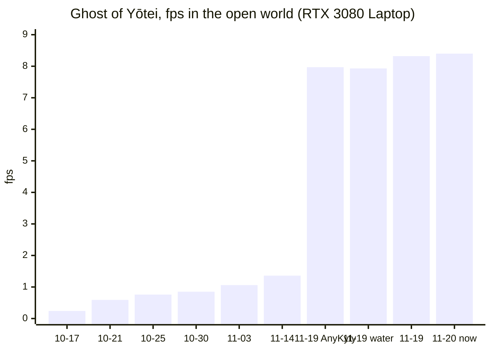

<h1 align="center">Ghost of Yōtei on AnyKyty</h1>

<p align="center"><b>Ghost of Yōtei (PPSA26344, v1.008) running in its open world on PC, on <a href="https://github.com/simnJS/AnyPS5/tree/AnyKyty">AnyKyty</a>: AnyPS5 with the Kyty graphics core.</b><br>
<sub>Branch <code>yotei/best</code> on Celegans12/AnyPS5-Ghost-of-Yotei · progress thread: <a href="https://github.com/boykopovar/AnyPS5/discussions/675">#675</a> · AnyKyty thread: <a href="https://github.com/boykopovar/AnyPS5/discussions/22713">#22713</a> · <a href="#run-it">run it</a> · <a href="#updates">updates</a></sub></p>

<table>
<tr>
<td align="center"><b>~8.5 fps</b><br><sub>in the world, 1080p<br>RTX 3080 Laptop (measured)</sub></td>
<td align="center"><b>~15 fps</b><br><sub>in the world, 1080p<br>RTX 4090 + i9-13900K (measured by Pipodi*)</sub></td>
<td align="center"><b>×35</b><br><sub>since the first time<br>in the open world (10-17)</sub></td>
<td align="center"><b>~40 s</b><br><sub>from the window<br>to the world (warm cache)</sub></td>
</tr>
</table>

> [!NOTE]
> A work-in-progress test branch, not upstream code: simnJS's `AnyKyty` (`8ebb72d680d`, 2026-11-21) plus 20 commits of
> ours. Fifteen of our PRs are merged into `AnyKyty` (the DLL build, the 11_11_10 blend, the ahead-walk deferral and the
> tiled-layout fix among them), so what is left here are KytyPS5 correctness fixes, shorter SRT walkers, a fix for a rare stop, and two
> switches that are off by default (in-place label deferral, simnJS/AnyPS5#167, and a per-shader GPU timer).
> Until 2026-11-17 this branch was AnyPS5's own GPU driver; that build is kept as
> [`yotei/best-anyps5-2026-11-17`](https://github.com/Celegans12/AnyPS5-Ghost-of-Yotei/tree/yotei/best-anyps5-2026-11-17).

## Where it stands (2026-11-19)

| | |
|---|---|
| **Furthest point** | Open world, from a save near Teshio Ridge (the river village with the canoe) |
| **Frame rate, laptop** | **about 88 presents per 10 s (~8.8 fps)** at 1080p with the [1080p patch](#run-it), standing still, 240 s legs, warm cache (three legs on 11-21: 88.8, 87.9 and 87.5; 88.9 on average for the build before it in the same session, so level within this laptop's spread of about ±3). GPU work per frame is about 12 % lower than before (70 against 79 ms) Measured on an i9-11900H + RTX 3080 Laptop 16 GB |
| **Frame rate, desktop (measured*)** | **152-154 presents per 10 s (~15 fps)** on an RTX 4090 + i9-13900K, the same save and settings. An RTX 5080 desktop should land in the same range |
| **Time to the world** | about 40 s after the window opens with a warm cache. The first run with an empty cache compiles its pipelines first and takes much longer (a few huge compute pipelines take minutes each in the NVIDIA driver) |
| **Picture** | Water, foliage, rocks and characters render correctly in our scene. Ray-traced effects don't run yet: AnyKyty doesn't serve Yōtei's compute-shader BVH walks, so those rays miss (simnJS/AnyPS5#111) |
| **Stability** | Our runs in the world are clean until we stop them; the depth-target crash of the earlier builds is fixed in `AnyKyty` |
| **Tested on** | Windows 11, RTX 3080 Laptop GPU 16 GB (driver 621.14), i9-11900H, 32 GB RAM; AnyPS5 with MinGW-w64 GCC 15.2.0, `kyty_gpu.prx` with llvm-mingw 20261104. Not tested on Linux |
| **Build** | `b574cc97e35` (simnJS `AnyKyty` `8ebb72d680d` + our 20 commits), plus this README, the 1080p patch and the Yōtei profile in `docs/yotei/` |

<sub>* Measured by Pipodi on 2026-11-20 with this branch at our save (#675, comment 19773554): 400 s legs on a filled cache, about
1.8 times our laptop, GPU around 77 % busy, about 4.7 cores used. Yōtei on Kyty is limited by the CPU side, so a faster GPU
alone changes little; our earlier estimate of 18-23 fps for a desktop was too optimistic. More numbers are welcome in #675.</sub>

## Speed over time



| Milestone | Date | fps (laptop) |
|---|---|---|
| First time in the open world, AnyPS5's own driver | 10-17 | 0.24 |
| Bindless, owned textures, the second Vulkan queue | 10-21 to 10-26 | 0.6-0.8 |
| 1080p patch, committer and preparer work from contributors | 10-30 to 11-03 | 0.85-1.06 |
| Best AnyPS5-driver build | 11-14 | 1.36 |
| **Moved to AnyKyty** (Kyty core as a libc++ DLL, PGO trained on Yōtei) | 11-19 | **7.97** |
| **Water fixed** | 11-19 | 7.93 |
| **Newest AnyKyty, exact 11_11_10 blend** | 11-19 | **8.32** |
| **Ahead SRT walks keep going past shader-only words** (+1.7 % in the same session) | 11-20 | **8.27** |
| **Profile retrained on the new code** (+3.4 % in the same session), a rare stop on a recycled texture slot fixed | 11-20 | **8.32** |
| **Ahead SRT walks read clean lines of GPU-written pages** (+6 % in the same sessions), newest AnyKyty, profile retrained | 11-21 | **8.88** |

<sub>Different days were measured in different sessions; this laptop's clocks drift by up to ~14 % between sessions, so
small steps aren't comparable across rows. The full table is [below](#how-the-frame-rate-got-here).</sub>

### Water: before and after the fix

<table>
<tr>
<td width="50%"></td>
<td width="50%"></td>
</tr>
<tr>
<td align="center"><sub>Before: the water appeared for a frame and faded out, so the riverbed showed</sub></td>
<td align="center"><sub>After (simnJS/AnyPS5#103): the water stays</sub></td>
</tr>
</table>

### Same code, three ways of building it

All three were measured in the same session, back to back, with the same save, settings and 300 s runs (older base):

| Build | Presents per 10 s |
|---|---|
| Kyty core linked into AnyPS5 (clang against GCC's libstdc++; AnyKyty's normal build) | 61.9 |
| Kyty core as `kyty_gpu.prx` (clang + libc++ + ThinLTO, AnyKyty's shared profile) | 74.2 (+20 %) |
| the same DLL with the profile trained on Yōtei (`docs/yotei/kyty_gpu-yotei.proftext`) | **79.7** (+29 % over the normal build) |

### What still limits it

- **Kyty's execution thread**, which prepares every draw, sets the frame time: the GPU is idle about 40 % of each frame. A
  quarter of that thread goes to per-draw program lookup and resource setup.
- **Write tracking:** about 13,700 guest write faults per second. About half are in the game's command buffers and a
  third next to GPU-written pages. simnJS is working on both in `AnyKyty`.
- **GPU work:** about 70 ms per frame on the laptop's GPU, which alone would cap it near 14 fps there.
- **Ray tracing** isn't served yet (see above), and **a cold first start** is slow.

## How the frame rate got here

The rows up to 11-17 are AnyPS5's own GPU driver (the old `yotei/best`); the row from 11-19 is AnyKyty. Rows from different days were measured in different sessions; this laptop's GPU clocks drift by up to ~14 % between sessions.

| Date | Presents per 10 s in the world | What changed |
|---|---|---|
| 10-17 | 2.35 | first time in the open world |
| 10-18 | 2.97 | cheaper draw-cache keys |
| 10-18 | 3.9 | texture revalidation walks only the readable parts of partly committed memory |
| 10-18 | 4.2 | hand-off PRs from upstream, copy-backs of changed dwords only |
| 10-18 | 4.6 | draw preparer thread, device-local buffers for the cloth compute programs |
| 10-19 | 5.0 | the cloth compute ring on its own Vulkan queue |
| 10-19 | +5 % presents, -8 % frame time vs the build above, same session | indirect-draw records read on the GPU, exact f32 path for f16 mix math (one pass 101 -> 27 ms GPU), presenter and barrier trims |
| 10-19 | **5.1** (+9 % in an in-run A/B, ~2.7 SE) | a dispatch run's staged copy-ins in one prelude with one barrier instead of a barrier per dispatch: the cloth queue's GPU time halves, GPU busy -26 % |
| 10-21 | **5.0** (the previous build got 4.19 in the same session: +19 % presents, -13 % frame time) | merged with `main` 2026-10-20; three fixes for slowdowns `main` added in the draw committer (buffer pool tiers, exact-size buffer reuse, held-read checks: +18 % in an in-run A/B); the second Vulkan queue off |
| 10-21 | **5.9** (lane off 5.45 in the same session: +8 % presents, -16 % median frame; provisional) | the cloth compute ring's second Vulkan queue back on, now on a compute-only queue family |
| 10-21 | +11 % in an in-run A/B (6.26 vs 5.62) | hritikutekar's two committer fixes: a count of prepared bindless tables instead of a full walk every 4 ms, and small texture snapshots in pooled slabs |
| 10-22 | **5.2** (the previous build with hritikutekar's fixes: 5.13 in the same session) | merged with `main` 2026-10-21; same speed, newer `main` underneath |
| 10-24 | +2.8 % / +2 % / +3 % in in-run A/Bs | hritikutekar's second committer batch; #7514; queue-0 dispatches through the draw pipeline (`APS5_PIPELINE_DISPATCH=1`) |
| 10-24 | even with the build before | merged with `main` 2026-10-24 |
| 10-25 | **7.6** (7.2 with them off in the same run: +8.5 %, frames ~100 ms shorter) | owned texture proofs: the committer's texture checks become a few word reads instead of a memory walk |
| 10-25 | +1.8 % in an in-run A/B | shahulmubeen-a's HTILE note for cache-hit dispatch items (#2) |
| 10-26 | **8.05** (7.70 with them off in the same run: +4.4 %, frames ~55 ms shorter) | owned reuse of untracked vertex/index inputs and draw snapshots; storage flushes wait only for the lanes that write the range |
| 10-26 | **7.8** (7.3 with all owned features off in the same run: +6.4 %, frames ~80 ms shorter) | the owned features made fault-free: write watch instead of write protection, answered from per-block checks within each collect epoch |
| 10-27 | **7.9** (the build before: 7.75 between two runs of this one, same script) | merged with `main` 2026-10-26; same speed, newer `main` underneath |
| 10-30 | **8.74** at 1080p (8.07 with them off in the same run: +8.4 %, GPU busy -170 ms per frame) | hritikutekar's resident device buffers for hot staged ranges: a staged range that's copied in again and again gets its own device buffer, and the copy-in is skipped while guest memory hasn't changed (copy-in 9,295 to 2,461 MiB per 10 s) |
| 10-30 | **8.46** at 1080p (7.76 / 7.64 at 4K in the runs either side: +9.9 %) | the game's output and render size set to 1920x1080 with a relinker patch (shahulmubeen-a's, ported to v1.008); at 4K the code runs at the same speed as the build before (7.98 against 7.95 / 7.91) |
| 11-03 | **10.60** at 1080p (10.30 / 10.03 for the build before in the runs either side: +4.3 %) | hritikutekar's preparer commits, Pipodi's miss-ahead builds and TheBlenDed's VRAM yield (gate off) |
| 11-03 | +5 % in an in-run A/B (9.80 vs 9.28, 23 pairs, ~4.6 SE) | `APS5_DEFER_LABEL_READBACK=1` and `APS5_RESOURCE_CACHE_LARGE=1`: label read-backs recorded behind their writer instead of a CPU wait, and a resource cache of at least 4,096 entries |
| 11-14 | **13.6** at 1080p on driver 621.14 (13.13 / 13.57 for the build before in the same session: about +2 %, within the spread) | kiansaeidnia's snapshot reads and APR file reads, Pipodi's pipeline prebuilds, eleven of slopezjur's driver commits and one of Zenodeon's |
| 11-14 | even with the build before (12.83 / 13.28 against 13.04 / 13.45 in alternating runs) | the GPU stack moved onto `main` 2026-11-13: `main`'s libraries, relinker and build under our driver and recompiler |
| 11-15 | even with the build before: 11.50 / 11.97 on the new `main` against 11.79 / 11.09 in four alternating 1,500 s runs at 1080p (+2.6 % on average, inside the spread: the build before alone moved 6 % between its two runs) | the same GPU stack moved from `main` 2026-11-13 to `main` 2026-11-15 (about 1,480 commits of `main`'s libraries, relinker and build) |
| 11-16 | level (+1.6 % / -0.4 % in two in-run A/Bs, inside the noise), GPU busy -6 %, staging-in GPU -36 % | `APS5_STAGING_DIFF_HANDOVER=1`: a staged range used twice in one batch keeps its device-local shadow and gets one changed-bytes copy-back |
| 11-17 | even with the build before within the spread: 11.01 / 11.22 on the new `main` against 10.88 / 12.11 in four alternating 1,500 s runs at 1080p (-3.3 % on average; the build before alone moved 11 % between its two runs, and the scene work per frame differed by 3-12 % between neighbouring runs, so no pair carries a speed claim) | the same GPU stack moved from `main` 2026-11-15 to `main` 2026-11-17 (about 2,060 commits of `main`, among them slopezjur's #20017, the fix for the `unsupported PM4 packet type` aborts reported on game 02.002.000) |
| 11-19 | **79.7** at 1080p on AnyKyty (74.2 for the same code without the Yōtei profile and 61.9 for AnyKyty's normal build, same session) | moved to AnyKyty (simnJS's AnyPS5 with the Kyty graphics core) with our Yōtei fixes, the Kyty core built as `kyty_gpu.prx` and a profile trained on Yōtei |
| 11-19 | **81.3** at 1080p (79.0 on the same base without it) | AnyKyty `b0f7dda885b`, and a guest fault that waits for a pending texture write-back no longer queues behind every other GPU command (21 ms to 0.7 ms per wait) |
| 11-19 | **79.3** at 1080p, water fixed | AnyKyty `97c16b5f271` with the depth-target crash fix, our water fix, the title framed with `--frame-red-zone` |
| 11-19 | **83.2** at 1080p | AnyKyty `de2889cc67b` (write blocks only in command buffers, more fixes), our exact 11_11_10 blend, the DLL commits of simnJS/AnyPS5#123; the title framed without `APS5_ALLOW_UNFRAMED_FAULTS` |
| 11-20 | **82.7** at 1080p (81.3 with `KYTY_FLAT_DEFER=0`, three alternating pairs in one session) | the same base; an SRT walk done ahead of execution no longer stops at a GPU-written page when only the shader reads that word (0 differences in 739,107 checked resolutions), and the 11_11_10 blend reads its destination back with a rounded-up reciprocal (simnJS/AnyPS5#119) |
| 11-20 | **83.2** at 1080p (four legs, 80.0 to 85.6) | the same code with the PGO profile trained again on it: **85.4 against 82.5** with the old profile, three alternating pairs in one session (+3.4 %). Then a fix for a rare stop (`TileGetTiledTextureLayout`) when a bindless texture slot is read while the game recycles it, and the profile trained once more on that final code; level with the build before it (83.2 against 83.1) |
| 11-20 | **83.5** at 1080p (three legs, 81.6 to 84.6; 83.5 for the build before it in the same session) | moved to AnyKyty `82039de9258` (texture tables served through the image heap, descriptor table writes), all our commits rebased, the profile trained on it |
| 11-20 | **85.8** at 1080p (three legs, 85.5 to 86.3; 84.6 for the build before it in the same session) | moved to AnyKyty `de0fa047bb0`: an empty buffer slot shares the bound shader variant (simnJS, from our finding), a CPU deadlock fixed; the profile trained on it. A first boot without a save now gets through the opening cinematic to the kanji prompt in about 23 minutes on the laptop (946 s of compile stalls; before: 1,594 s and stuck in the cinematic at 30 minutes) |
| 11-20 | **85.4 and 81.7** at 1080p (85.7 and 86.4 for the build before it in the same session: level within the spread) | moved to AnyKyty `ce8cd4221e1`: the cloth/particle solver hang fixed (stale parameter block), the heap corruption in parallel shader compiles fixed, a new image-table shape of a compute shader runs at once on a wider module instead of freezing for its compile; all our PRs merged upstream |
| 11-21 | **88.1 and 89.5** at 1080p (86.0 for the build before it in the same session) | moved to AnyKyty `0c09d875506` (guest write faults handled without the region lock, signal delivery fixes) with the profile trained on it, and a new step of ours: an SRT walk done ahead of execution reads a word on a GPU-written page from the CPU copy when its 64-byte line holds no GPU bytes, and the execution thread checks every such read before it uses the result. About 55,000 resolutions per 10 s now finish ahead that used to be redone. On the build before this move: **89.8 against 84.6** with it off (seven and six legs over three sessions, +6 %); exact, 0 differences in three verify legs that compare every such resolution with a full one |
| 11-21 | **88.8, 87.9 and 87.5** at 1080p (88.9 on average for the build before it in the same session: level) | moved to AnyKyty `8ebb72d680d`: simnJS's resolve thread now reads around GPU writes and prepares image-heap programs ahead (his version of our clean-line reads, measured on Yōtei, so ours is dropped), GPU-produced control words are left to the GPU, wave64 compute runs as two 32-wide halves; with our shorter SRT walkers (KytyPS5, exact: 0 differences in about 14 million compared walks) and the profile trained on it. GPU work per frame 70 against 79 ms: particles about half, the cloth solver about 20 % slower |

## Run it

**Windows only for now** (we've only built the DLL there). You need the usual AnyPS5 toolchain
([build instructions](docs/dev/BUILD.md)) and, for `kyty_gpu.prx`, [llvm-mingw](https://github.com/mstorsjo/llvm-mingw)
(we use the 20261104 release). First turn the Yōtei profile into the indexed form clang reads, with the
`llvm-profdata` from the same llvm-mingw:

```
llvm-profdata merge -o kyty_gpu-yotei.profdata docs/yotei/kyty_gpu-yotei.proftext
```

Then configure and build:

```
cmake -S . -B build -G Ninja -DCMAKE_BUILD_TYPE=Release -DCMAKE_C_COMPILER=gcc -DCMAKE_CXX_COMPILER=g++ ^
  -DANYPS5_GPU_BACKEND=kyty -DANYPS5_KYTY_DLL=ON ^
  -DANYPS5_KYTY_DLL_C_COMPILER=<llvm-mingw>/bin/x86_64-w64-mingw32-clang.exe ^
  -DANYPS5_KYTY_DLL_CXX_COMPILER=<llvm-mingw>/bin/x86_64-w64-mingw32-clang++.exe ^
  -DANYPS5_KYTY_DLL_PGO=USE -DANYPS5_KYTY_DLL_PGO_PROFILE=<full path>/kyty_gpu-yotei.profdata
cmake --build build
```

Without `-DANYPS5_KYTY_DLL=ON` you get AnyKyty's normal build (about 20 % slower here). The build puts
`kyty_gpu.prx` next to the other libraries, and libSceAgcDriver loads it at startup.

For 1080p (recommended), add the patch file [`docs/yotei/yotei-1.008-1080p.toml`](docs/yotei/yotei-1.008-1080p.toml)
to your relinker command. It is shahulmubeen-a's 1080p patch for 02.002.000, ported to v1.008; this build's relinker
applies all five of its sites. It is for v1.008 only (app0/eboot.bin md5 `748168945449666277eb772f7a371cbc`).

```
python tools/unwrap_self.py <dump>/app0/eboot.bin eboot.elf
relinker <your usual options> --frame-red-zone --patches docs/yotei/yotei-1.008-1080p.toml eboot.elf <runtime>/eboot.exe
```

**`--frame-red-zone` is the relinker's default on this base** (a Windows conversion with the Kyty backend frames the red zone by itself; passing the option is harmless). AnyKyty tracks guest writes with page faults, and on Windows a fault can overwrite values a leaf function keeps below the stack pointer, so AnyKyty stops at startup unless the title was converted with it. In Yōtei 1.008 the relinker frames 404 of the 406 such functions and lists the last 2 in the title's mark; AnyKyty then only stops if a fault lands inside those 2 small ranges, which didn't happen in our runs. A build of the earlier `yotei/best` (older relinker) still needs `APS5_ALLOW_UNFRAMED_FAULTS=1`.

Our numbers are measured with:

```
KYTY_ASYNC_PIPELINES=0 KYTY_GPU_SPIN_US=0
```

- `KYTY_ASYNC_PIPELINES=0` makes a draw wait for its pipeline instead of skipping it while the pipeline compiles in
  the background, so nothing pops in. `2` crashed for us, and AnyKyty's default is back to `1` while simnJS traces a heap corruption with `2`.
- `KYTY_GPU_SPIN_US=0` is simnJS's recommended setting (no 2 ms spin before a GPU wait).
- Every other AnyKyty setting is at its default; [the AnyKyty page](docs/user/ANYKYTY.md) lists them all.
- Leave `ANYPS5_VBLANK_HZ` unset; with `240` the earlier builds crashed.

## Known issues

- **Exit after a fatal error can hang.** If the log ends in `--- Fatal Error ---` and the window doesn't close, end
  `eboot.exe` in Task Manager.
- The PGO profile was trained on one save, standing in the world. Other scenes may gain less than the 7.5 % it gave
  here; we haven't measured them.

## What it carries on top of AnyKyty

Most of these are ports of fixes and speed work from our earlier Kyty-in-AnyPS5 port (built on Erlou's KytyPS5-Yotei
and DaftFuzz's work on it), redone for AnyKyty's core:

- **Shader permutations that settle**: buffer, image and sampler candidates are padded,
  so the warm cache stops growing by ~100 pipelines per session in the same scene.
- **Manifest modules with up to 16,384 resources of a kind**.
- **Ahead walks without page faults**: on top of AnyKyty's own SRT walker probe, walks ahead of execution on the
  resolve thread no longer take an access violation on GPU-written pages.
- **libc `GuestWritable` from the published guest protections**.
- **11_11_10 UNorm colour targets, exact**: a replace blend is a plain export, and any other blend is done in the pixel
  shader under fragment shader interlock (simnJS/AnyPS5#119). Without it Yōtei stops at its first load on plain AnyKyty.
  It replaces the approximation the earlier builds used (rendering the target as `B10G11R11_UFLOAT`).
- **Pointer-table images in the image heap**, bounded at the null slot.
- **The Kyty core as `kyty_gpu.prx`** (simnJS/AnyPS5#123): a versioned C seam; the core and the
  AgcDriver shim built with clang + libc++ + ThinLTO; loaded by libSceAgcDriver at startup; host reports over the seam.
- **The surface named in the error** when no tiled layout fits it.
- **Pending texture write-backs flushed on the urgent queue for guest faults** (off with `KYTY_URGENT_WRITEBACK_WAIT=0`):
  about +3 %.
- **The water fix**: a buffer fill of a stencil plane is only turned into a clear while the depth image holds that plane
  (off with `KYTY_FIX_STENCIL_FILL_HELD_PLANE=0`). Yōtei fills its second stencil plane every frame, and that fill used to
  wipe the water bits of the other plane, so the water appeared for a frame and faded out. Follows KytyPS5-Yotei's M119
  (Erlou).
- **The RT probe export test** runs only without the DLL build.

simnJS merged our padding, manifest, ahead-walk, `GuestWritable` and image-heap commits (#86-#89), the write-back change
(#100), the water fix (#103), the flat image-table index (#117) and the tiled-layout message (#118) into `AnyKyty`. Our commit hashes changed with the rebase; `git log` lists them.

## Updates

- 2026-11-21, afternoon: moved to AnyKyty `8ebb72d680d`, which has simnJS's version of our ahead-read speed-up (measured on
  Yōtei) and several fixes, so this branch now carries fewer commits of ours. Speed at our save is level with the build
  before it (88.8, 87.9 and 87.5 against 88.9 on average). New: `KYTY_GPU_TIME=1` prints GPU time per shader and per game
  pass every 10 s. On this laptop about 35 ms of the ~79 ms of GPU work per frame went to the cloth and particle
  simulation; on this base the particles cost about half, while the cloth solver got about 20 % slower. Off by default:
  `KYTY_COMMAND_MEMORY_IN_PLACE=1 KYTY_IN_PLACE_LABEL_DEFER=1` (simnJS's in-place memory with our label deferral,
  simnJS/AnyPS5#167); on this laptop it is still a little slower than the normal path. `KYTY_TRACE_BRINGUP` is gone.
- 2026-11-21: moved to AnyKyty `0c09d875506` and added one speed-up of our own. When a draw's shader resources are
  resolved ahead of time, the walk used to stop at any memory page the GPU had written, and the execution thread then
  redid the whole resolution. Now the walk reads the word from the CPU copy when the 64-byte line around it holds no
  GPU-written bytes, and the execution thread checks every such read before using the result, so it stays exact (three
  verify legs, 0 differences). About 55,000 resolutions per 10 s finish ahead that way. Measured on the build before
  this move: 89.8 presents per 10 s with it against 84.6 without (+6 %). `KYTY_AHEAD_CLEAN_LINES=0` turns it off. The
  new upstream base handles guest write faults without the region lock and fixes signal delivery; the profile in
  `docs/yotei/` is trained on exactly this code. This build: 88.1 and 89.5 against 86.0 for the one before it.
- 2026-11-20, night: moved to AnyKyty `ce8cd4221e1`. This is mostly a stability step: simnJS fixed the GPU hang in the
  cloth and particle solver (it read a stale copy of its parameter block; Pipodi had two GPU resets from it) and the heap
  corruption in parallel shader compiles (the silent exits in first boots; we and Pipodi had caught it with ProcDump).
  Pipodi ran a fully cold first boot with both fixes to the kanji prompt with no error. A new image-table shape of a
  compute shader now runs at once on a wider module instead of freezing while it compiles. Speed at our save is level:
  85.4 and 81.7 presents per 10 s against 85.7 and 86.4 for the build before it. The profile in `docs/yotei/` was trained
  one upstream commit earlier and does not cover the reworked program lookup yet; a retrained one follows. All our
  PRs are merged upstream now (fifteen), so `--frame-red-zone` is the relinker's default and no add-on setting is needed.
- 2026-11-20, evening: moved to AnyKyty `de0fa047bb0`. simnJS's fix for the variant repeats we reported is in it: an
  empty buffer slot now shares the compiled variant of the bound one, so the big cloth and particle solvers compile far
  less often on a first boot. Our no-save first boot on the laptop reached the kanji prompt at about 23 minutes with no
  error (two nights ago it was still in the tree cinematic at 30 minutes). At our save it runs **85.8 presents per 10 s**
  against 84.6 for the build before it (three alternating pairs). Two things to know:
  - Pipodi had two GPU resets (driver TDR) about 15 minutes into a fully cold boot with the sharing on, on an RTX 4090.
    We had none on the laptop. If you get one, run with `KYTY_SHARE_EMPTY_BUFFERS=0` and please report it in #675.
  - New and off by default: `KYTY_EAGER_READBACK=1` copies GPU-written windows back before the game faults on them.
    It halves the time game threads wait on readbacks, but it is neutral on our laptop, where another thread sets the
    pace. On a desktop it may help: an on/off comparison would be very welcome.
- 2026-11-20, midday: moved to simnJS's newest AnyKyty (`82039de9258`), with our commits rebased and the profile
  trained on it. Speed is level with the build before it (83.5 against 83.5, three alternating pairs). On this base
  the texture tables go through the image heap, and there the `[kyty-tiled] declined` case does come up in normal
  runs (once in three legs); without the fix that was a stop.
- 2026-11-20, later: the PGO profile in `docs/yotei/` is trained again on the current code, since the functions
  changed since 11-19 had lost their counts: **85.4 against 82.5 presents per 10 s** with the old profile on the same
  code (three alternating pairs). The build also no longer stops on `Not implemented (!TileGetTiledTextureLayout…)`
  when a bindless texture slot holds a descriptor with a tile mode the console doesn't have (seen four times in test
  builds, never in a normal run): such a candidate is bound as a null image and logged as `[kyty-tiled] declined`.
  The final build measures 83.2 (four legs, 80.0 to 85.6), level with the one before the fix.
- 2026-11-20: SRT walks done ahead of execution now keep going past words only the shader reads, so about a
  third of the walks that used to be redone on the execution thread finish ahead: **82.7 presents per 10 s**
  against 81.3 with `KYTY_FLAT_DEFER=0` in the same session (three alternating pairs; exact, 0 differences in the
  verify mode). Sessions on this laptop drift by a few percent, so compare it with that 81.3, not with the 83.2 below.
  The 11_11_10 blend fix from the review of simnJS/AnyPS5#119 is in too.
- 2026-11-19: moved to AnyKyty `de2889cc67b` with our exact 11_11_10 blend and the DLL commits of simnJS/AnyPS5#123:
  **83.2 presents per 10 s** (79.3 for the build before). `APS5_ALLOW_UNFRAMED_FAULTS=1` is no longer needed.

- 2026-11-19: **the water is fixed.** Moved to AnyKyty `97c16b5f271` (with simnJS's fix for the depth-target crash) plus
  our water fix: 79.3 presents per 10 s, level with the build before (81.3), now with steady water. The title has to be
  converted with `--frame-red-zone` and run with `APS5_ALLOW_UNFRAMED_FAULTS=1`.

- 2026-11-19: moved to AnyKyty `b0f7dda885b` plus the urgent write-back flush: 81.3 presents per 10 s (79.0 on the same
  base without it, 79.7 for the build before).
- 2026-11-19: moved `yotei/best` from AnyPS5's own driver to AnyKyty (simnJS `b00e259664b` + 18 commits + the Yōtei
  profile): 79.7 presents per 10 s at 1080p, about six times the old branch. The old branch is
  `yotei/best-anyps5-2026-11-17`; its update history is in that branch's README.

---

> **AnyKyty** is AnyPS5 with the Kyty graphics core: **182.9 FPS** in Subnautica uncapped, against 112.4 for native Kyty on the same PC (Ryzen 9 7950X3D, RTX 4080 SUPER).
> Linux and Windows, built from source. Contributors and game reports are welcome: **[the AnyKyty page](docs/user/ANYKYTY.md)** has the numbers, the build commands, the settings and how to contribute.

# AnyKyty

**AnyKyty is this fork's branch: AnyPS5 running the Kyty graphics core as a second GPU backend.** It is experimental (v0). The upstream AnyPS5 README follows [below](#about).

## What changes

AnyPS5 keeps everything it does today: the relinker, `libkernel`, every system library, the SDL window, input and audio, and `libSceAgc`, the AGC library games call. Only the GPU driver behind the AGC interface is swapped at configure time:

| | `-DANYPS5_GPU_BACKEND=anyps5` (default) | `-DANYPS5_GPU_BACKEND=kyty` (AnyKyty) |
|---|---|---|
| PM4 command processing | AnyPS5 driver (decode, finishers, committer, encoder) | Kyty command processor (`kytyGpu`) |
| Draw preparation | AnyPS5 committer | Kyty resolve and execute threads, with the ordered resolution and compiled SRT walk |
| Vulkan rendering and caches | AnyPS5 renderer | Kyty renderer, buffer, texture and pipeline caches, recorder thread |
| Shader recompiler | AnyPS5 recompiler (`core/shader/recompiler`) | Kyty recompiler (`core/kyty/graphics/shader/recompiler`) |
| GPU view of game memory | AnyPS5 imports and write tracking | Kyty model: every guest page has a second view, writes are tracked by page faults |
| Presentation | AnyPS5 presentation | Kyty presenter and swapchain, on AnyPS5's window; AnyPS5's VideoOut still reserves, paces and presents the flips |

The default build is AnyPS5 as before: it compiles none of the Kyty files. The Kyty core lives in `core/kyty/`, maintained in this repository and derived from [KytyPS5](https://github.com/KytyPS5/KytyPS5) (GPL-2.0); the glue between it and AnyPS5 (memory, faults, entry points, presentation, events) lives in `core/libs/prx/libSceAgcDriver/KytyShim/`. Changes to shared AnyPS5 files are under `ANYPS5_KYTY`, except the optional `ANYPS5_VBLANK_HZ` setting, which leaves behaviour unchanged when it is not set. Kyty's general shortcuts are kept as they are, for example skipping a draw while its pipeline compiles in the background. Its title-specific hooks (Demon's Souls page freeing, ASTRO BOT, Oodle) are not ported. AnyKyty also turns on by default two Kyty settings that native Kyty only enables in its launcher's Experiment mode, draw templates and grouped draw buffers (`KYTY_DRAW_TEMPLATES=2`, `KYTY_DRAW_BUFFERS=1`); setting either variable keeps the user's value. It also copies GPU-written images back at the GL2 write-backs the game requests rather than at the next suspend point (`KYTY_WRITE_BACK_IMAGES=0` restores KytyPS5's behaviour; see `docs/dev/THIRD_PARTY_KYTY.md`). Native ray tracing, which native Kyty's launcher turns on in its recommended settings, is on by default when the GPU supports it (`KYTY_NATIVE_RT`, see the runtime settings below).

## Why

On the same PC and scene, native Kyty spent about a third of AnyPS5's CPU time per draw and a fifth of its GPU time per frame. Reworking the AnyPS5 driver towards that design piece by piece did not close the gap, so the whole graphics core was transplanted instead.

## Measurements

Subnautica (PPSA02453), Creative mode, inside the lifepod. Ryzen 9 7950X3D, RTX 4080 SUPER, Ubuntu 26.04, 17 Nov 2026. Busiest stage = the thread with the highest CPU cost per draw call.

Capped at 60 Hz:

| | FPS | Busiest stage | GPU per frame |
|---|---|---|---|
| AnyPS5, default backend | 45.7 | 15.5 µs per draw (committer) | 12.2 ms |
| AnyKyty (`e6dfd952b5`, before the fixes below) | 59.8 | 6.7 to 7.7 µs per draw (`kytyGpuExecute`) | 6.5 ms |
| Kyty, native | 59.4 | 5.7 µs per draw | 5.7 ms |

Uncapped (`ANYPS5_VBLANK_HZ=360`, native Kyty with `KYTY_VBLANK_FREQUENCY=360`), two sessions each. Both sides ran with Kyty's default settings (its Original mode): these measurements predate the Experiment settings above, and native ray tracing was off on both sides, which makes no difference in Subnautica since it has no ray tracing pass.

| | FPS | Execute | Resolve | Record | GPU per frame |
|---|---|---|---|---|---|
| AnyKyty (`6155614613`) | 159.0 (157.2, 160.8) | 5.73 µs per draw | 5.14 µs | 3.54 µs | 3.9 ms |
| Kyty, native | 112.4 (106.3, 118.6) | 7.23 µs | 6.26 µs | 4.00 µs | 5.0 ms |

At a comparable draw count (911 against 863 per frame), every Kyty stage is 12 to 21 % lighter per draw on AnyKyty and the GPU 22 % lighter per frame. The latest gains come from the glue: inside the Kyty stages, the memory shim now sits in the ThinLTO object and TLS is initial-exec; on the game threads, guest memory copies no longer go through system calls and submissions no longer `msync`, which leaves more of the CPU to the stages. Native Kyty's presentation thread is replaced here by AnyPS5's VideoOut. Why AnyKyty now beats native Kyty is not fully attributed yet. Subnautica loads a slightly different world on each launch, and per-draw costs vary by about ±20 % between sessions; both sessions show the same trend. Loading the game from the Creative menu takes 3.5 s on AnyKyty, 4.0 s on native Kyty and 8.3 to 13.9 s on the default backend, with warm caches.

## Status

- Tested in game on Linux: Subnautica, Balatro and TCG Card Shop Simulator.
- Known issue, inherited from the Kyty core: the street of TCG Card Shop Simulator stays almost black, as it does on native Kyty. Rendering differences against the default backend are being collected and will be fixed after performance work.
- The Kyty backend is built and run on Linux. On Windows it builds, and an open-world AAA title reaches its prologue in game on an NVIDIA GPU; nothing else has been tested there.

## Building AnyKyty

Follow [BUILD](docs/dev/BUILD.md), then configure with:

```
cmake -B build -DANYPS5_GPU_BACKEND=kyty
```

On Windows the rest of AnyPS5 is built with MinGW-w64 GCC as usual, and `clang`, `clang++` of an LLVM release (tested with 21.1.8) must be on `PATH`: they compile the Kyty core for the `x86_64-w64-windows-gnu` target against the headers and libstdc++ of that GCC (`ANYPS5_KYTY_SYSROOT`, by default the directory above the `bin` of `g++`). ThinLTO is off there, since lld cannot pre-link Windows objects, and Kyty's pipeline helper processes are not used.

The Kyty core does not build with GCC, so it is compiled by Clang in a sub-project, against the same libstdc++ as the rest of AnyPS5. It needs `clang`, `clang++` and an `ld.lld` of the same major version (tested with 21). It is built with ThinLTO and pre-linked into one object by default; `-DANYPS5_KYTY_THIN_LTO=OFF` turns that off.

Runtime settings: `ANYPS5_VBLANK_HZ` (30 to 360) sets the vblank rate, so `ANYPS5_VBLANK_HZ=240` lifts the 60 FPS cap of games that pace on vblank. The `KYTY_*` settings of the Kyty core are read from the environment, for example `KYTY_VBLANK_FREQUENCY` and `KYTY_PRESENT_MODE`.

Native ray tracing (Kyty's `--native-rt`) is on by default when the Vulkan device has `VK_KHR_acceleration_structure`, `VK_KHR_ray_query` and `VK_KHR_deferred_host_operations`: the ray tracing passes whose BVH walk Kyty recognizes trace with the GPU's ray tracing hardware, and the other ones run emulated in shaders as before. A `[kyty] native ray tracing` line on the console says which way it went; on a GPU without these extensions it names what is missing and ray tracing runs emulated. `KYTY_NATIVE_RT=0` emulates all ray tracing; `KYTY_NATIVE_RT=1` stops with a message when the GPU cannot trace natively. `KYTY_RT_STATS=1` prints a `[RT]` summary every 10 s of the work native ray tracing leaves to the game. The acceleration structures Kyty builds take at most a quarter of the video memory, between 512 MiB and 4 GiB (2 GiB on an 8 GB card), allocated as needed; `KYTY_RT_ARENA_MB` sets another limit.

## Branches

- `AnyKyty` (default): AnyPS5 with the Kyty backend.
- `feat/agc-draw-block`: the performance work on AnyPS5's own driver.
- `main`: a copy of upstream AnyPS5.

## Credits and licence

The graphics core: `core/kyty` is maintained in this repository; it derives from [KytyPS5](https://github.com/KytyPS5/KytyPS5) (GPL-2.0), itself built on Kyty by InoriRus; everything else is [AnyPS5](https://github.com/boykopovar/AnyPS5). The Kyty core is GPL-2.0 like AnyPS5; the original Kyty code by InoriRus is MIT. File by file origin and licences: [docs/dev/THIRD_PARTY_KYTY.md](docs/dev/THIRD_PARTY_KYTY.md).

---

**English** | [Português (Brasil)](docs/user/README.pt-BR.md) | [Español](docs/user/README.es.md) | [Català](docs/user/README.ca.md) | [Italiano](docs/user/README.it.md) | [简体中文](docs/user/README.zh-CN.md) | [Русский](docs/user/README.ru.md) | [Bahasa Indonesia](docs/user/README.id.md) | [Polski](docs/user/README.pl.md) | [日本語](docs/user/README.ja.md)

# About

Tool for automatic executables porting to Linux and Windows.

The relinker-only build runs on macOS, including Apple silicon.

[**Web converter**](https://boykopovar.github.io/AnyPS5/) - files stay on your device.


Includes a [relinker](core/relinker) that converts executable to the target system's native format and implementations of [system prx libraries](core/libs/prx) suitable for dynamic linking. No emulation or separate runtime process.

[**Discord**](https://discord.gg/x9naWVzC6A), [Usage](docs/user/USAGE.md), [Build instructions](docs/dev/BUILD.md), [Architecture](docs/dev/ARCHITECTURE.md), [Technical debt of the project](docs/dev/TechnicalDebt.md), [code style conventions](docs/dev/CONVENTIONS.md), [contributing](CONTRIBUTING.md)

## Status

[](https://boykopovar.github.io/AnyPS5/progress.html) [](https://boykopovar.github.io/AnyPS5/progress.html) [](https://boykopovar.github.io/AnyPS5/progress.html) [](https://boykopovar.github.io/AnyPS5/history.html)

[](https://boykopovar.github.io/AnyPS5/progress.html)

[Progress history](https://boykopovar.github.io/AnyPS5/history.html)

<sub>* System libraries: percentage of the functions known to the project so far (declared in [core/libs/prx](core/libs/prx)), not of every PS5 system function. The total grows as more functions are declared.</sub>

Unsupported or unexpected states throw a C++ exception, usually `std::runtime_error`. An exception that nothing catches prints its `what()` to stderr and ends the process.

The [shader recompiler](core/shader/recompiler/Recompiler.cpp) successfully produces SPIR-V (validated via [Spirv-Tools](3rdparty/SPIRV-Tools) when built with `ANYPS5_ENABLE_SPIRV_TOOLS`).

## Compatibility

Per-game status and test reports live in the [Game bring-up](https://github.com/boykopovar/AnyPS5/discussions/categories/game-bring-up) discussions, one thread per title.

## Input mapping

SDL-mapped game controllers are supported, including analog sticks and triggers. Keyboard and mouse controls can be configured with an `anyps5-input.ini` file. See [input mapping](docs/user/INPUT_MAPPING.md) for the supported devices and configuration format.

## Disclaimer

This project is intended for interoperability, research, preservation, and compatibility purposes. It does not include, distribute, or require copyrighted software, firmware, cryptographic keys, or proprietary libraries. Users are responsible for ensuring that any binaries used with this project are obtained and used in accordance with applicable laws and their respective license terms.

AnyPS5 is an independent project and is not affiliated with, authorized or endorsed by Sony Interactive Entertainment. "PlayStation" and "PS5" are trademarks of Sony Interactive Entertainment Inc.

## License

This project is licensed under the GNU General Public License version 2 only.
