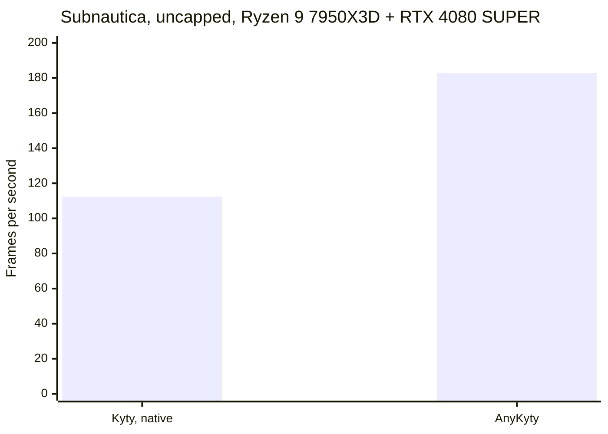
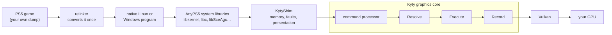

<div align="center">

# AnyKyty

**PS5 games as native Linux and Windows programs, with the Kyty graphics core on Vulkan.**

[](https://github.com/simnJS/AnyPS5/actions/workflows/anykyty.yml)
[](LICENSE)
[](docs/dev/START_HERE.md#build)
[](#status)
[](https://github.com/simnJS/AnyPS5/issues?q=is%3Aissue+is%3Aopen+label%3A%22good+first+issue%22)
[](https://github.com/simnJS/AnyPS5/discussions)

**[Start here](docs/dev/START_HERE.md)** · **[Roadmap](https://github.com/simnJS/AnyPS5/issues?q=is%3Aissue+is%3Aopen+in%3Atitle+%22Start+here%22)** · **[Test a game](https://github.com/simnJS/AnyPS5/issues/141)** · **[Architecture v2](https://github.com/simnJS/AnyPS5/issues/168)**

</div>

AnyKyty takes a PS5 game you dumped yourself and turns it into a program your PC runs directly: no emulator, no virtual machine. The [AnyPS5](https://github.com/boykopovar/AnyPS5) relinker converts the game once, AnyPS5's system libraries answer its calls, and the Kyty graphics core turns its GPU work into Vulkan. It is young and experimental, built from source, and moving fast.

## Why it is worth a look

- **Faster than native Kyty on the same PC.** Subnautica, uncapped: 182.9 FPS on AnyKyty against 112.4 for native Kyty ([measured](#measured)).
- **Current-generation games run.** Ghost of Yōtei, made for the PS5, reaches the game, and so do 007 First Light, Stray and Cyberpunk 2077 ([status](#status)).
- **Linux and Windows, NVIDIA and AMD.** Every pull request that changes code is built and tested on both systems, and contributors run titles on GPUs the maintainers don't have.
- **Built in the open, measured in the open.** Thirteen people besides the maintainer already have code in the graphics core or its glue. Every speed change comes with an in-run A/B on the same scene, and AI-assisted work is welcome.
- **Experiments that pay off.** In an experiment ([#150](https://github.com/simnJS/AnyPS5/issues/150)), a Rust model of the memory tracker replayed 299.6 million in-game calls identically to the C++ tracker, and writing its specification found four bugs in the C++, now fixed. The tracker that ships stays C++.

## Measured



<details>
<summary>How these numbers were taken</summary>

Subnautica, Creative mode inside the lifepod, warm shader and pipeline caches, uncapped (`ANYPS5_VBLANK_HZ=360` on AnyKyty, `--vblank-frequency 360` on native Kyty), the other settings at their defaults. Ryzen 9 7950X3D, RTX 4080 SUPER (NVIDIA 595.99.02), Ubuntu 26.04. AnyKyty: two sessions on 18 Nov 2026 (`e535bb49ed`), 177.2 and 188.7 FPS. Native Kyty: two sessions on 17 Nov 2026, 106.3 and 118.6 FPS. Subnautica loads a slightly different world on each launch, so treat the gap as approximate, not the decimals.

CPU time per draw call in the same sessions, one thread per stage:

| Stage | AnyKyty | Native Kyty |
|---|---|---|
| Execute | 3.64 µs | 7.23 µs |
| Resolve | 3.08 µs | 6.26 µs |
| Record | 2.49 µs | 4.00 µs |
| Command processor | 1.59 µs | 3.40 µs |

From a contributor, 007 First Light's first cutscene: 29.6 FPS (one run of 106 s, 20 Nov 2026, `82039de925`, with the game patch below), RX 9070 XT with RADV (Mesa 26.2.6), Linux ([#32](https://github.com/simnJS/AnyPS5/issues/32)).

</details>

## Status

As of 22 Nov 2026 (`AnyKyty` at `a4b4360d66`). **PS5 titles only**: the Kyty driver, now the only one, does not run PS4 titles (GNM). The maintainers run on Linux with an NVIDIA GPU; a link marks a contributor's report.

| Game | Engine | Tested on | Last run | State |
|---|---|---|---|---|
| Ghost of Yōtei | in-house, made for the PS5 | Linux, NVIDIA; Windows, NVIDIA laptop, with the contributor's own changes ([#55](https://github.com/simnJS/AnyPS5/issues/55)) | 21 Nov | In game. Slow: one CPU thread, Execute, holds the frame rate ([#168](https://github.com/simnJS/AnyPS5/issues/168)); a cold first start compiles shaders for minutes ([#33](https://github.com/simnJS/AnyPS5/issues/33)) |
| Stray | Unreal Engine 4 | Linux, NVIDIA; Windows, NVIDIA laptop ([#180](https://github.com/simnJS/AnyPS5/issues/180)) | 21 Nov | Plays. The first launch stutters while shaders compile ([#33](https://github.com/simnJS/AnyPS5/issues/33)) |
| Octopath Traveler II | Unreal Engine 4 | Linux, NVIDIA | 18 Nov | In game (prologue) |
| Subnautica | Unity | Linux, NVIDIA | 21 Nov | Plays |
| TCG Card Shop Simulator | Unity | Linux, NVIDIA | 18 Nov | Plays |
| LEGO Builders Journey | Unity | Windows, NVIDIA ([#21](https://github.com/simnJS/AnyPS5/issues/21)) | 18 Nov | First launch runs; a second launch can stop while loading |
| 007 First Light | Glacier | Linux, AMD with RADV ([#98](https://github.com/simnJS/AnyPS5/issues/98), [#32](https://github.com/simnJS/AnyPS5/issues/32)) | 22 Nov | Menus, cutscenes and gameplay, no GPU hang since 21 Nov. Needs a 5-byte patch of the game ([details](https://github.com/simnJS/AnyPS5/issues/98)) |
| Cyberpunk 2077 | REDengine 4 | Windows, NVIDIA ([#160](https://github.com/simnJS/AnyPS5/issues/160)) | 21 Nov | In game; stutters while new pipelines compile |
| The Witcher 3: Wild Hunt | REDengine 3 | Windows, AMD ([#186](https://github.com/simnJS/AnyPS5/issues/186)) | 22 Nov | Does not convert without a local relinker patch ([#187](https://github.com/simnJS/AnyPS5/issues/187)); then stops on the loading screen |
| Planet Zoo | Cobra | Windows, NVIDIA ([#30](https://github.com/simnJS/AnyPS5/issues/30)) | 19 Nov | Runs; most of the 3D scene is drawn wrongly |
| METAL GEAR SOLID 4 | in-house | Linux, NVIDIA ([#24](https://github.com/simnJS/AnyPS5/issues/24)) | 19 Nov | In game |
| Balatro | LÖVE | Linux, NVIDIA | 21 Nov | Plays |

Missing so far: any Unreal Engine 5 title, any Intel GPU, and a title that reaches the game on Windows with AMD. A report of any title, working or not, helps: [#141](https://github.com/simnJS/AnyPS5/issues/141).

## How it works



The game's own code runs natively on your CPU. Its command buffers go through the Kyty stages, one thread each: the command processor decodes them, Resolve prepares resources ahead, Execute records each draw and dispatch, Record submits to Vulkan. On GPU-driven games Execute is the limit today, and [architecture v2](https://github.com/simnJS/AnyPS5/issues/168) is the plan to remove that work.

## Quick start

Linux: Git, CMake 3.21 or newer, Ninja, GCC 14 and LLVM 21 (`clang`, `clang++`, `ld.lld` and `llvm-profdata`, on `PATH`).

```sh
git clone --recurse-submodules https://github.com/simnJS/AnyPS5.git
cd AnyPS5
cmake -S . -B build -G Ninja -DCMAKE_BUILD_TYPE=Release -DBUILD_TESTING=OFF \
  -DCMAKE_C_COMPILER=gcc-14 -DCMAKE_CXX_COMPILER=g++-14 -DANYPS5_KYTY_JOBS="$(nproc)"
cmake --build build --target kyty_gpu libs relinker --parallel "$(nproc)"
```

Convert the extracted, decrypted executable of your game, put the libraries (`build/core/libs/libs/*.prx`) in a `libs/` folder beside the output, and start it:

```sh
build/core/relinker/relinker source/input.elf app.elf
./app.elf
```

No setting is needed: the defaults are the fastest and most stable choices measured.

<details>
<summary>Windows, packages, tests and player options</summary>

- Windows (WinLibs GCC 15.2 and LLVM 21), the package list for Ubuntu, and how to run the tests: [Start here](docs/dev/START_HERE.md#build).
- The options a player may want (fullscreen, GPU, output resolution, frame-rate cap): [the AnyKyty page](docs/user/ANYKYTY.md#settings).
- Conversion options, module folders and add-ons: [usage](docs/user/USAGE.md).

</details>

## Join us

**Goal #1: finish [architecture v2](https://github.com/simnJS/AnyPS5/issues/168), properly.** Every step removes old machinery, until Ghost of Yōtei runs close to its GPU wall; the [roadmap](https://github.com/simnJS/AnyPS5/issues?q=is%3Aissue+is%3Aopen+in%3Atitle+%22Start+here%22) says what comes first. There is work at every size around it, and most of it needs no knowledge of the code base yet.

| You have | You can |
|---|---|
| 30 minutes and a PS5 game you dumped | [Test it and send the report](https://github.com/simnJS/AnyPS5/issues/141), or [survey its ray tracing](https://github.com/simnJS/AnyPS5/issues/111) |
| An AMD or Intel GPU, or Windows | Run the tests or a title on hardware the maintainers don't have: [`needs: AMD`](https://github.com/simnJS/AnyPS5/issues?q=is%3Aissue+is%3Aopen+label%3A%22needs%3A+AMD%22), [`needs: Windows`](https://github.com/simnJS/AnyPS5/issues?q=is%3Aissue+is%3Aopen+label%3A%22needs%3A+Windows%22) |
| An evening and some C++ or Python | Pick a [good first issue](https://github.com/simnJS/AnyPS5/issues?q=is%3Aissue+is%3Aopen+label%3A%22good+first+issue%22) |
| A taste for GPUs and performance | Take a step of [architecture v2](https://github.com/simnJS/AnyPS5/issues/168), or a [`hard`](https://github.com/simnJS/AnyPS5/issues?q=is%3Aissue+is%3Aopen+label%3Ahard) issue |

Read [Start here](docs/dev/START_HERE.md) before your first pull request: building, testing, measuring, the rules, and how a pull request gets in. Questions go to [Discussions](https://github.com/simnJS/AnyPS5/discussions).

## Credits and licence

AnyKyty is built on two projects. **[AnyPS5](https://github.com/boykopovar/AnyPS5)** by boykopovar and its contributors gives the relinker and every system library; its own README is [upstream](https://github.com/boykopovar/AnyPS5#readme). **[KytyPS5](https://github.com/KytyPS5/KytyPS5)**, built on Kyty by InoriRus, gives the graphics core, which is maintained in this repository under `core/kyty`.

AnyPS5 and the Kyty core are distributed under the GNU General Public License version 2 ([LICENSE](LICENSE)); the original Kyty code by InoriRus is MIT. File by file origin and licences: [docs/dev/THIRD_PARTY_KYTY.md](docs/dev/THIRD_PARTY_KYTY.md).

AnyKyty is for interoperability, research, preservation and compatibility. It does not include, distribute or require copyrighted software, firmware, keys or proprietary libraries, and no game is provided: use only games you own and dumped yourself, as the law where you live allows. It is an independent project, not affiliated with, authorised or endorsed by Sony Interactive Entertainment. "PlayStation" and "PS5" are trademarks of Sony Interactive Entertainment Inc.
