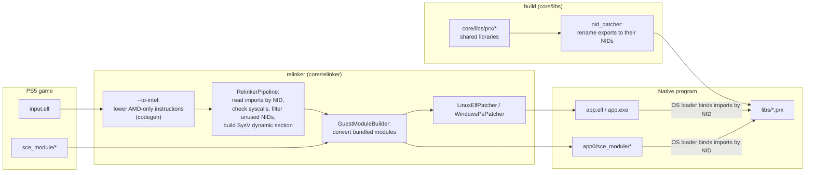

# Architecture

How a PS5 executable becomes a native Linux or Windows program. Nothing is emulated: the converted executable runs as a normal process and calls native implementations of the system libraries.

## Overview

- `Conversion::Convert` in [`Conversion.cpp`](../../core/relinker/relinker/src/pipeline/Conversion.cpp), called from [`core/relinker/main.cpp`](../../core/relinker/main.cpp), runs the steps in this order. `--to-intel` is optional, see [USAGE.md](../user/USAGE.md).
- Each library in [`core/libs/prx`](../../core/libs/prx) builds as a shared library. After the build, `nid_patcher` ([`core/libs/nid`](../../core/libs/nid)) renames every export to its NID, computed from the function name. `APS5_EXPORT("<nid>", func)` sets the NID directly when the name is unknown. Every other library keeps the names libc exports; it reads them from `libc.exports`, which `nid_patcher --write-export-list` rewrites only when that list changes. On Windows the link writes each import library with `SOURCE_DATE_EPOCH=0` and `ranlib -D` and replaces it only when its bytes change. A source edit that keeps the exports therefore relinks and re-patches only its own library.
- On Windows and Linux, bundled modules come before AnyPS5's libraries when an import is looked up. On Windows the entry stub ([`WindowsEntryStubBuilder.cpp`](../../core/relinker/elfpatcher/src/windows/WindowsEntryStubBuilder.cpp)) tries the converted `app0` modules before `libs`, by symbol name first and then by NID, and takes the first module that exports it; it also adds the host `libc.prx` to the search of every other host import. Imports from `libSceLibcInternal.prx` are the exception: the stub tries the host `libSceLibcInternal.prx` and `libc.prx` first and the bundled `libc.prx` last, skipping its exports that only return zero. On Linux [`GuestModuleBuilder.cpp`](../../core/relinker/relinker/src/guest/GuestModuleBuilder.cpp) lists the guest modules loaded at startup before every host library in the executable's `DT_NEEDED`, `libSceLibcInternal.prx` included. A title that ships its own `libc.prx`, `libSceJobManager.prx` or other module therefore runs that module's code for the imports that name its library and that it exports, and the host library serves the rest.

## Main-module entry registers

The host stubs that transfer control to the guest `e_entry` are not the same on every platform, and the console's register contract at that point is not measured here (#9048). What the stubs establish today:

| Host | Source | `rdi` | `rsi` | `rdx` | `rbp` | Return from entry |
|---|---|---|---|---|---|---|
| Linux | [`EntryStubBuilder.cpp`](../../core/relinker/elfpatcher/src/general/EntryStubBuilder.cpp) | process stack: qword `argc`, then argv pointers, then a null | 0 | left as the host dynamic linker left it (often `rtld_fini`) | zero frame `{0, 0}` | `ud2` |
| Windows | [`WindowsEntryStubBuilder.cpp`](../../core/relinker/elfpatcher/src/windows/WindowsEntryStubBuilder.cpp) | `VirtualAlloc` block: qword `argc`, UTF-8 argv pointers, null | address of an exit trampoline that finalizes guest modules and returns | not set by the stub (last host call is `FreeLibrary`) | zero frame in the stub's stack | `ExitProcess` with the entry's return code |
| macOS | [`MacOsImage.cpp`](../../core/relinker/elfpatcher/src/macos/MacOsImage.cpp) | guest entry address into `_Aps5StartGuest_nid_no_patch` | stack block `{argc, argv…, 0, envp…, 0}` | — | — | [`Aps5StartGuest`](../../core/libs/prx/libkernel/Pthread/src/MainThreadMacOs.cpp) runs the guest entry as `entry(block, nullptr)` on a new thread with at least an 8 MiB stack (the main thread keeps serving its run loop); a return from the entry prints `guest entry returned` and aborts |

On Linux the argument block is the process stack itself (`mov rdi, rsp`). On Windows it is a separate allocation the stub fills with UTF-8 argument strings. Titles that read only `argc`/`argv` through `rdi` see the same layout shape on both; titles that call through `rsi` on Windows get a host exit path that Linux does not provide (`rsi` is zero there).

## Game patches

[`GamePatch.cpp`](../../core/relinker/relinker/src/patching/GamePatch.cpp) parses the patch file, a strict subset of TOML. `Conversion::Convert` applies the entries of its own target to the executable bytes right after reading them, and to each bundled module before `GuestModuleBuilder` reads it, so every later stage sees patched bytes. Entry virtual addresses are translated through the `PT_LOAD` segments, and a range may not touch the ELF header or program header table, which the output writers rewrite. The patched file ranges are then checked against every in-place writer: the `--to-intel` reports and trampoline sites, the `--frame-red-zone` frame sites and moved displacements, `RelinkPatch` records and syscall trap ranges. The patched virtual address ranges are checked against the 8-byte targets of the `RelaData` and `RelaPltData` relocations, which the loader or the output writers overwrite. `main.cpp` builds the manifest text before it writes any output. `main.cpp` matches targets after the conversions, aggregates the applied records into `<output-stem>.patches.toml`, and runs `--verify-patches` through `GamePatch::VerifyPatches`, which reads only bytes. For a `--windows` output `Conversion::Convert` records each executable entry's `output_rva` from `WindowsLoadImage::GetRva`, and `VerifyPatches` finds those bytes through the PE section table.

## Windows deferred module initialization

Runtime-loaded Windows modules export `__aps5_guest_initialize`: the entry RVA, the initializer count and the RVAs of initializer pointer slots. [DynamicLoader.cpp](../../core/libs/prx/libkernel/Module/src/DynamicLoader.cpp) consumes the first two words in the mapped image after initialization, so another reference to that image does not run it again. Unloading the image discards this state; a later load reads the original table from the file, including when Windows reuses the same base address. Native references outside the guest handle table retain the same initialized image.

While initialization runs, the count is `UINT32_MAX` and the entry word holds the initializing Windows thread ID. A different thread waits on the loader's condition variable; the owning thread can recursively open its module. Completion clears both words, restores the table's original page protection and wakes waiters. An exception leaves the count at `UINT32_MAX` with thread ID 0, so another load rejects that image until it is unloaded. The table's file format is unchanged and its initializer slots remain intact.

[GuestDeferredModule.cpp](../../core/libs/tests/GuestDeferredModule.cpp) checks repeated loads at the same base, multiple guest references, an external native reference, concurrent initialization and recursive loading. The Windows fixture uses the same table layout as the relinker and reports its entry and constructor calls separately.

## Windows allocator

On Windows, a relinked game run with `APS5_MIMALLOC` set (to any value) allocates through [mimalloc](../../3rdparty/mimalloc) instead of the C runtime's heap: its libraries and the C and C++ runtime they use. Without the variable the game keeps the C runtime's heap.

- The build copies `mimalloc.dll` and `mimalloc-redirect.dll` beside the libraries ([`core/libs/CMakeLists.txt`](../../core/libs/CMakeLists.txt)). [`pe_import_first`](../../core/libs/allocator/PeImportFirst.cpp) moves `mimalloc-redirect.dll` to the front of the copied `mimalloc.dll`'s import directory. The redirection module has to load before mimalloc, and MinGW's linker does not keep that order.
- When `APS5_MIMALLOC` is set, the relinker's Windows entry stub ([`WindowsEntryStubBuilder.cpp`](../../core/relinker/elfpatcher/src/windows/WindowsEntryStubBuilder.cpp)) loads `mimalloc.dll` from the run path with `LoadLibraryExW` before the first library. `mimalloc-redirect.dll` then sends the C runtime's allocation functions in `ucrtbase.dll` (`malloc`, `calloc`, `realloc`, `free` and their relatives) to mimalloc for the whole process. The libraries loaded after it, and the MinGW runtime DLLs they use (`libstdc++`, `libgcc_s`, `libwinpthread`), allocate and free through mimalloc.
  - Without `mimalloc.dll` the load fails quietly and the process keeps the C runtime's heap. With a relative run path, a module directory too long for the stub's path buffer skips the load the same way.
  - A run path whose `mimalloc.dll` path cannot fit that buffer fails the relink, as a library path does.
- Guest code, the executable and its bundled modules, allocates through libc's guest heap ([`GuestHeap.cpp`](../../core/libs/prx/libc/src/GuestHeap.cpp)). The guest heap takes its blocks from the guest arena, or from `malloc` when there is no arena, and returns them the same way, so a block never moves between the guest heap and the host allocator.
- `mimalloc.dll` links the MinGW runtime statically, and three parts of it allocate through the C runtime: GCC's emulated thread-locals (`emutls`, which hold mimalloc's own thread-locals), MinGW's thread-exit destructor list and winpthreads.
  - After the redirection these calls would enter mimalloc again, before the calling thread's mimalloc state exists.
  - Linker wraps send them to [`RuntimeHeap.c`](../../core/libs/allocator/RuntimeHeap.c), which allocates from the process heap (`HeapAlloc` on `GetProcessHeap()`). The same code frees these blocks through the same wraps.

## macOS and Linux allocator

On macOS and Linux, a relinked game run with `APS5_MIMALLOC` set (to any value) allocates through [mimalloc](../../3rdparty/mimalloc) instead of the system allocator: its libraries, the C and C++ runtime and the system libraries and frameworks they call, the Vulkan driver among them. Without the variable the game keeps the system allocator.

- The build copies `libmimalloc.dylib` (macOS) or `libmimalloc.so` (Linux) beside the libraries ([`core/libs/CMakeLists.txt`](../../core/libs/CMakeLists.txt)). It keeps mimalloc's defaults: it interposes the C allocation functions and `operator new` and `operator delete`, on macOS also the default malloc zone and on Linux also glibc's `__libc_malloc` family. As on Windows, `mi_free` checks the pointers it gets.
  - On Linux, glibc's `malloc_trim`, which the shader registry calls, then has nothing to trim; mimalloc returns freed memory to the system itself.
  - A Linux build with `ANYPS5_ENABLE_ASAN` or `ANYPS5_ENABLE_TSAN` has no mimalloc: the sanitizer's runtime replaces the allocation functions itself and has to be the first library loaded.
- The dynamic linker binds the allocation functions to mimalloc only when it loads mimalloc at launch, from `DYLD_INSERT_LIBRARIES` (macOS) or `LD_PRELOAD` (Linux). When `APS5_MIMALLOC` is set and mimalloc is not loaded, a constructor in libkernel ([`MimallocRestart.cpp`](../../core/libs/prx/libkernel/System/src/MimallocRestart.cpp)) puts the mimalloc library beside libkernel first in that variable, sets `APS5_MIMALLOC_RESTARTED` and runs the same executable again with `execv`, with the same arguments and the same process ID. On Linux the executable is the target of `/proc/self/exe` and the arguments are those of `/proc/self/cmdline`, so a title started through `ld.so` starts through it again. The restarted process removes `APS5_MIMALLOC_RESTARTED` from its environment.
  - The constructor has priority 101, so it runs before libkernel's other initializers, which have no priority, and none of their work is done twice or carried into the restarted process. It calls only the host C and C++ runtimes and libc, separate libraries that libkernel depends on, so they have initialized before it.
  - libc's `ANYPS5_LOG_FILE` copy has taken the standard streams by then. libkernel gives them back before `execv`, as LoadExec does, and the restarted process starts the copy again.
  - Without the mimalloc library beside libkernel the title does not restart and keeps the system allocator.
  - The variable cannot list a path that has its separator, a colon (and on Linux a space): the title prints one line and keeps the system allocator.
  - When the dynamic linker ignores the variable, as for an executable with the hardened runtime on macOS or one that runs in secure-execution mode on Linux (set-user-ID or with file capabilities), the restarted process prints one line and keeps the system allocator instead of restarting again.
  - The variable stays set, so a process the title starts also allocates through mimalloc.
- mimalloc asks for its arenas at addresses from 2 TiB up, above the guest arena's range; the few blocks it maps without that hint come from the system like any other host mapping. Guest code allocates through libc's guest heap, as on Windows.

## Thread cancellation

[`Thread.cpp`](../../core/libs/prx/libkernel/Pthread/src/Thread.cpp) records cancellation requests on the target guest thread. New threads start with cancellation enabled and deferred. A disabled request stays pending; enabling deferred cancellation returns before the next cancellation point acts on it. Repeated requests do not add cleanup invocations.

[`Cancel.hpp`](../../core/libs/prx/libkernel/Pthread/include/Cancel.hpp) connects condition, semaphore and join waits to the request. A canceled condition waiter reacquires its guest mutex before cleanup. Semaphore and join waits release their internal locks before exiting. A request pending on entry to a semaphore wait is acted on before consuming an available token; a canceled join leaves its target joinable and its result output untouched.

Cancellation exits through `scePthreadExit` with result pointer `1`. It runs cleanup handlers in reverse push order before thread-specific destructors; cancellation points inside cleanup must not start another exit. The host thread then terminates through the existing Windows or Linux lifecycle, and join waits for that termination. Host thread termination is not used to inject cancellation into a running guest frame.

The reference contract and constants come from FreeBSD libthr, pinned at [`5ed7eb0d`](https://github.com/freebsd/freebsd-src/blob/5ed7eb0d97ba4436218e810f61bd059acba984c2/lib/libthr/thread/thr_cancel.c), with cleanup and exit ordering in [`thr_exit.c`](https://github.com/freebsd/freebsd-src/blob/5ed7eb0d97ba4436218e810f61bd059acba984c2/lib/libthr/thread/thr_exit.c#L196-L259). These are reference semantics, not console measurements. The supported cancellation points and incomplete asynchronous behavior are listed in the [libkernel technical debt](debt/libkernel.md).

[`GuestPthreadCancelRecovery.cpp`](../../core/libs/tests/GuestPthreadCancelRecovery.cpp) checks pending requests before ordinary and timed semaphore acquisition, cleanup reentrancy and destructor ordering, enabled and disabled timed condition waits, canceled join output, and subsequent resource and thread reuse. Host atomic gates establish pending requests; acquiring the condition mutex after the worker releases it establishes wait entry without a scheduling sleep. Both `guest_pthread_cancel_recovery` and `guest_pthread_cancel_recovery_coarse` retain checks in Release and have a 20-second timeout, shorter than the 60-second guest waits. The latter sets `APS5_COARSE_TIMED_WAITS=1` to exercise the Windows fallback; Linux uses that condition-variable path by default.

## APR and AMM command buffers

[`Apr.cpp`](../../core/libs/prx/libkernel/Apr/src/Apr.cpp) executes APR and AMM command buffers. A buffer runs on the submitting thread until a `WaitOnAddress` or `WaitOnCounter` that is not yet satisfied; the rest of it, and every buffer submitted after it, is copied and runs on a worker thread, so a submitter that satisfies the wait after the submit returns does not hang. A buffer without such a wait completes before the submit returns only when the queue is idle; while an earlier buffer is running or still pending, it is copied behind it and the submit returns its id before it has run (`sceKernelAprWaitCommandBuffer` waits for it).

APR and AMM each have their own queue and worker thread. Order is kept inside a queue; a wait in one does not hold up the other, because AMM `WriteAddress` commands advance the counters that APR buffers wait on. Submission ids are per queue, and `sceKernelAprWaitCommandBuffer` and `sceAmprAmmWaitCommandBufferCompletion` block until the queue has completed that id. A command that throws on a worker aborts the process.

[`GuestAmpr.cpp`](../../core/libs/tests/GuestAmpr.cpp) checks both cases: a submit whose wait is satisfied afterwards returns and keeps buffer order, and an AMM buffer submitted after a waiting APR buffer still completes.

## Graphics

The Kyty core is the only GPU driver. `core/libs/prx/libSceAgc` and `libSceAgcDriver/Submit` write and accept the command buffers, [`KytyShim`](../../core/libs/prx/libSceAgcDriver/KytyShim) hands them to `core/kyty`, which recompiles the RDNA shaders to SPIR-V and records the Vulkan work, and `libSceVideoOut` presents the frames in the AnyPS5 window. [Kyty code in AnyPS5](THIRD_PARTY_KYTY.md) describes the folders and the settings; [AnyKyty](../user/ANYKYTY.md) is the user page.

### Log output

`WriteLogLine` ([`LogMacros.hpp`](../../core/libs/prx/libc/include/general/LogMacros.hpp), behind `APS5_LOG_OUT` and `APS5_LOG_ERR`) formats a line on the calling thread and hands it to the process's `LogSink()` when one is installed; without a sink it writes and flushes it there. Nothing installs a sink in AnyKyty: the asynchronous logger of the historical GPU driver was removed with it.

A direct print is one write. The MinGW-w64 start-up code makes stderr unbuffered (`setvbuf(stderr, NULL, _IONBF, 0)`), and on MinGW `std::fprintf` and `std::printf` are `__mingw_fprintf` and `__mingw_printf`, which hand each character to `fputc`, so a line used to reach the operating system one character per `WriteFile`: slow on a console or a redirected file, and cut mid-word by other threads. Two changes make a call one write. Every library links [`SingleWriteStdio.cpp`](../../core/libs/prx/libc/src/specifics/windows/SingleWriteStdio.cpp) with `--wrap` (`configure_single_write_stdio` in [`core/libs/CMakeLists.txt`](../../core/libs/CMakeLists.txt)): the call formats into a buffer (1 KiB of stack, the heap for longer text) and passes it to one `fwrite`. And `HostStandardErrorFile_nid_no_patch` and `HostStandardOutputFile_nid_no_patch`, behind the `stderr` and `stdout` of every library, set the buffer size UCRT keeps for an unbuffered stream from 2 to 1 (`WriteUnbufferedStreamWhole_nid_no_patch` in [`General.cpp`](../../core/libs/prx/libc/src/General.cpp)): with 2, `fwrite` and `fputs` write a text of odd length as all but its last byte and then that byte. The stream stays unbuffered, so the text is with the operating system when the call returns, as before, and nothing has to be flushed before a crash report or between stdout and stderr; only the text of a call that dies while formatting no longer appears in part. A line built by several calls is still several writes, and on a text-mode stream the C runtime splits a write of more than about 5 KiB.

`ANYPS5_LOG_FILE=<path>` (libc, [`LogFile.cpp`](../../core/libs/prx/libc/src/LogFile.cpp)) adds a copy of the runtime log that does not go through `WriteLogLine` or the sink. At load, libc keeps the real standard output and error, diverts descriptors 1 and 2 (the standard handles on Windows) into two pipes and starts one thread per pipe. Each thread writes what it reads to the kept stream at once and each whole line to the file under one lock, so a line of one stream never lands inside a line of the other. A line without a newline stays in a bounded carry (1 MiB) and is written to the file when it ends, when the carry is full or when the process ends. The crash and abort reporters do not use the pipes: `log_file::CrashWrite` takes the lock for at most 250 ms, moves what is still in the pipes into the file and writes the report to the kept stderr and the file directly. `LibcRunEndFlush_nid_no_patch` and an `atexit` handler drain at the end; `LogFileRelease_nid_no_patch` puts the real streams back before `sceSystemServiceLoadExec` replaces the process. Unset or empty, nothing is created.
